# Episode 0: Set up Python for machine learning

The video: [**Machine learning from scratch**, episode 0](https://youtu.be/BakqOBRhFIA), on
[MP_Studio's YouTube channel](https://www.youtube.com/@mpstudioapp).

Every step and command from the video, with screenshots, for Windows, Mac and
Linux. By the end you have:

- **conda**, installed with Miniforge (free);
- a box (a conda environment) called `ml` with Python 3.14 and the four
  tools the series uses: pandas, scikit-learn, matplotlib and JupyterLab;
- your first notebook, running.

It takes four steps. After step 1, every command is the same on all three
systems.

**Already have conda?** Skip to [The quick way](#the-quick-way).

---

## Step 1: Get conda

Miniforge is conda's free installer from conda-forge, a community-run
collection of packages. If you already have Anaconda, that is conda too: skip
to step 2, every command works the same.

Open **[conda-forge.org/download](https://conda-forge.org/download/)**.
There's one installer for each system.

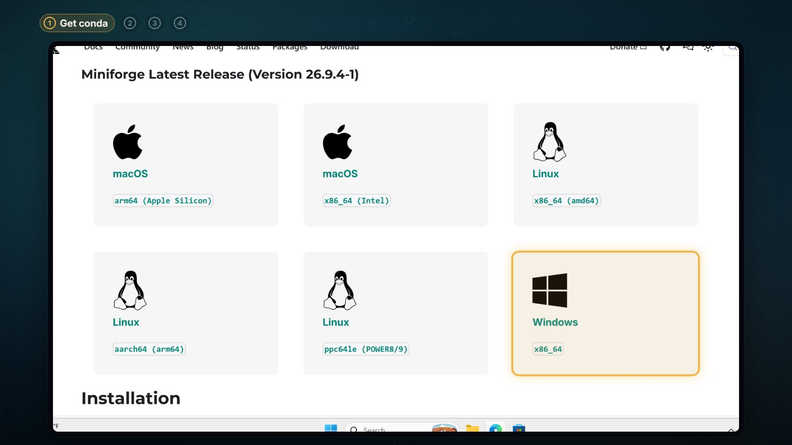

### On Windows

1. Click the **Windows** installer (`x86_64`). When it has downloaded, click
   **Open file**.

   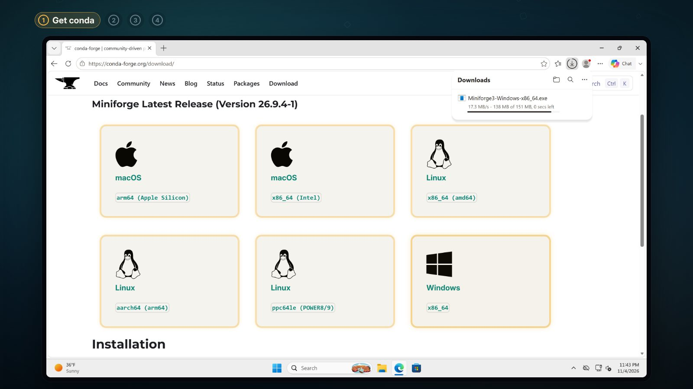

2. The installer starts. Click **Next**, then **I Agree**.
3. Choose **Just Me (recommended)**, click **Next**, and keep the folder it
   suggests (`C:\Users\<you>\miniforge3`).

   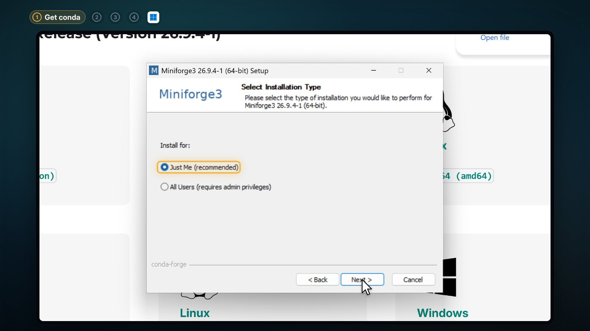

4. On **Advanced Installation Options**, leave **Add installation to my PATH
   environment variable** unticked. The installer leaves it off on purpose:
   it can clash with other programs.

   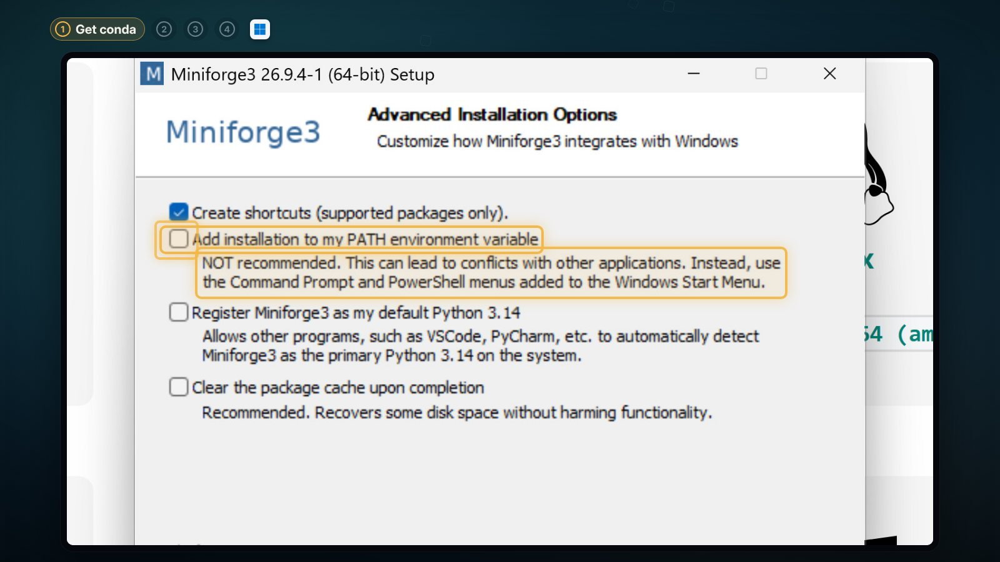

5. Click **Install** and give it a minute. When it's done, click **Next**,
   then **Finish**.
6. Open the Start menu, type `Miniforge`, and click **Miniforge Prompt**.

   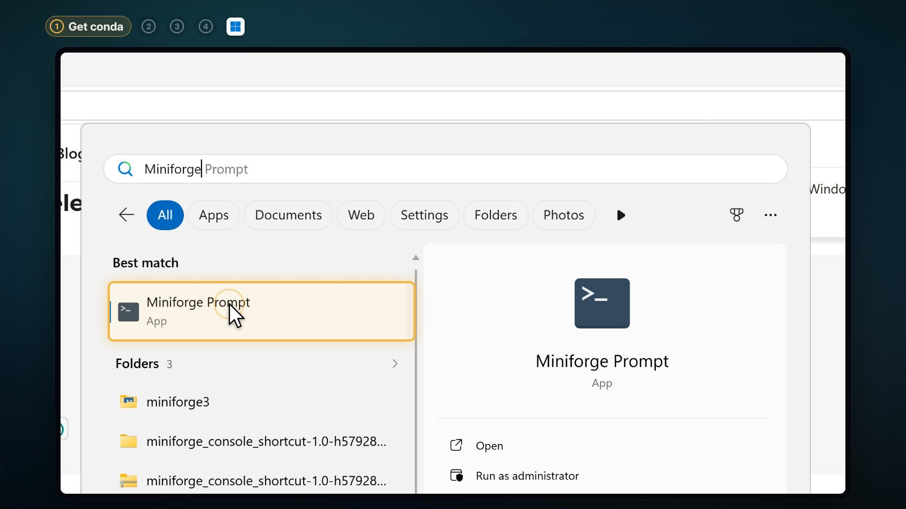

7. That's the window you type every command into. The word `(base)` at the
   start means conda is ready.

   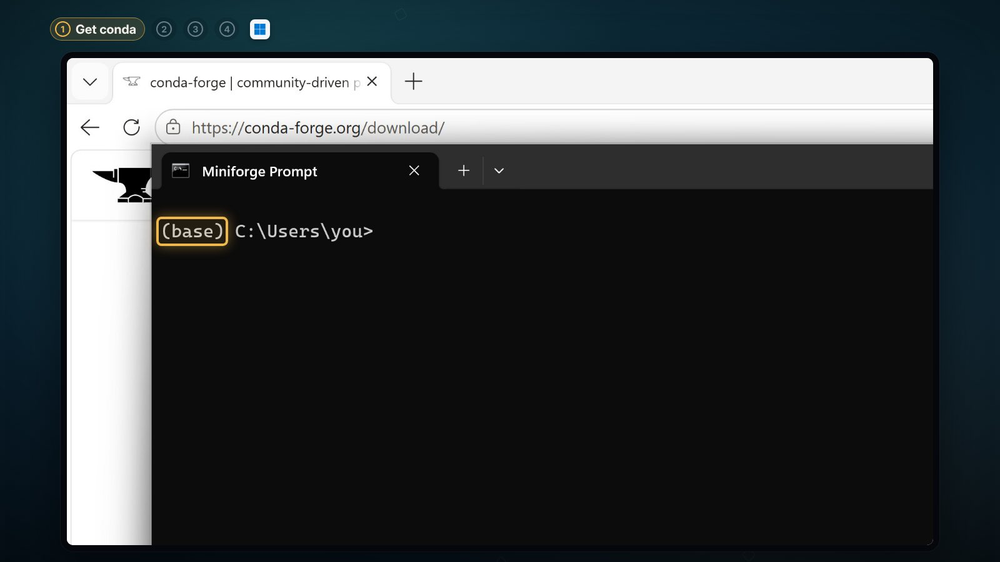

### On a Mac or Linux

You don't need the browser: two lines in the terminal do it. On a Mac, open
the **Terminal** app; on Linux, open your terminal.

1. Download the right installer:

   ```sh
   curl -L -O "https://github.com/conda-forge/miniforge/releases/latest/download/Miniforge3-$(uname)-$(uname -m).sh"
   ```

   The parts in brackets ask your computer what it is: `$(uname)` gives
   `Linux`, or `Darwin` on a Mac, and `$(uname -m)` the kind of chip
   (`x86_64`, `arm64`). So everyone gets the right file without choosing.

   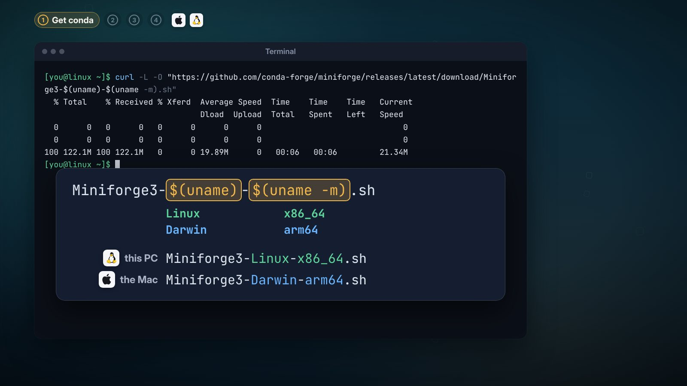

2. Run it:

   ```sh
   bash Miniforge3-$(uname)-$(uname -m).sh
   ```

   It asks a few questions. Answer them like this:

   | It says | You type |
   | --- | --- |
   | `Please, press ENTER to continue` | Enter |
   | the license, page by page | `q` when you've read it |
   | `Do you accept the license terms? [yes\|no]` | `yes` |
   | `Press ENTER to confirm the location` | Enter (keeps `~/miniforge3`) |
   | `Proceed with initialization? [yes\|no]` | `yes`, so conda starts in every new terminal |

   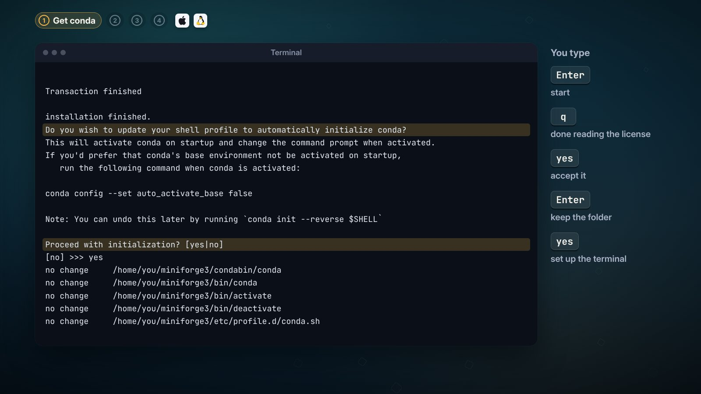

3. Close the terminal and open a new one. The word `(base)` at the start
   means conda is ready.

   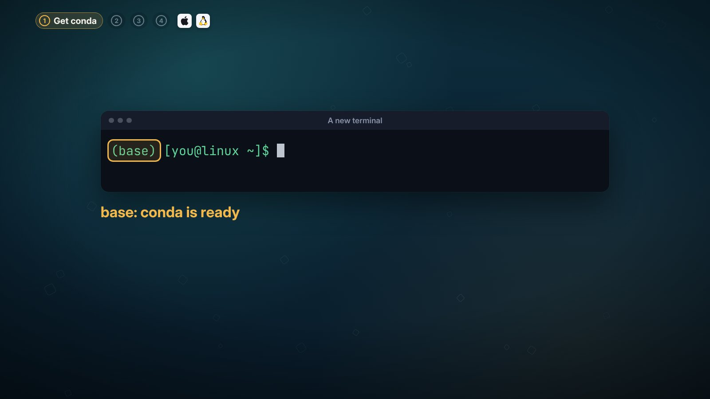

---

## Step 2: Make your box

A box (a conda environment) is a folder with its own Python and its own
libraries. Every project gets its own, so changing one leaves the others as
they were. The box for this series is called `ml`, with Python 3.14:

```sh
conda create -n ml python=3.14
```

Conda lists everything it will put in the box and asks
`Proceed ([y]/n)?`. Type `y`.

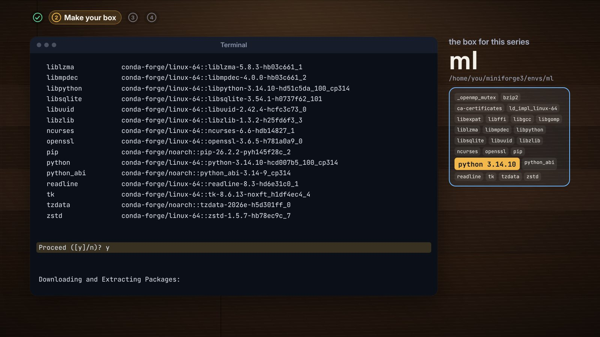

Step inside the box. The start of the line changes from `(base)` to `(ml)`:

```sh
conda activate ml
```

Ask where Python is now: the one inside the `ml` folder.

```sh
which python     # Mac and Linux
where python     # Windows
```

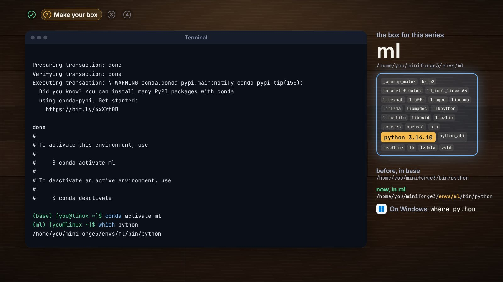

---

## Step 3: Fill it with tools

Inside the box (`(ml)` at the start of the line), install the four tools:

```sh
conda install pandas scikit-learn matplotlib jupyterlab
```

You ask for four, and conda brings the libraries they rely on (about two
hundred, NumPy among them), every version checked to fit. Type `y` when it
asks.

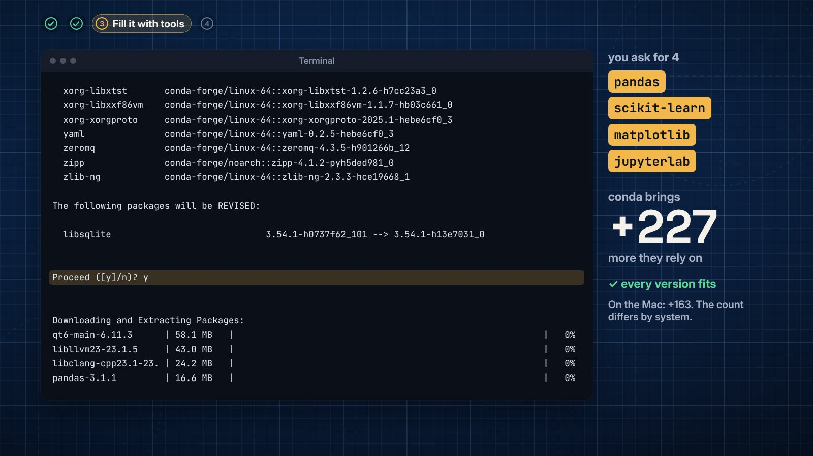

| Tool | What it does |
| --- | --- |
| NumPy | the fast engine the other tools are built on |
| pandas | holds your data as a table you drive with code |
| matplotlib | draws the charts |
| scikit-learn | the ready-made models: fit on examples, then predict |
| JupyterLab | the notebook, where code, results and notes sit side by side |

Check it. Inside the box, Python finds scikit-learn:

```sh
python -c "import sklearn; print(sklearn.__version__)"
```

Step out of the box and ask again: `No module named 'sklearn'`. Outside the
box, it isn't there. That's the separation, working.

```sh
conda deactivate
python -c "import sklearn; print(sklearn.__version__)"
```

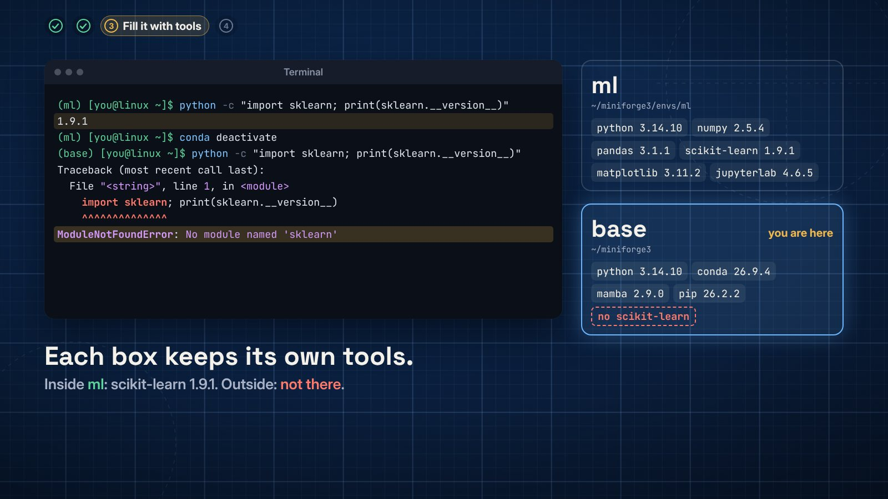

---

## Step 4: Your first notebook

Step back into the box and start JupyterLab:

```sh
conda activate ml
jupyter lab
```

Your browser opens JupyterLab. Under **Notebook**, click **Python 3
(ipykernel)**.

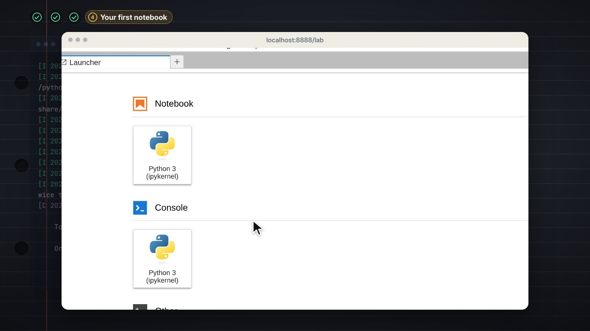

Type this into the first cell:

```python
import pandas as pd
pd.__version__
```

Press **Shift + Enter**. The answer appears right below.

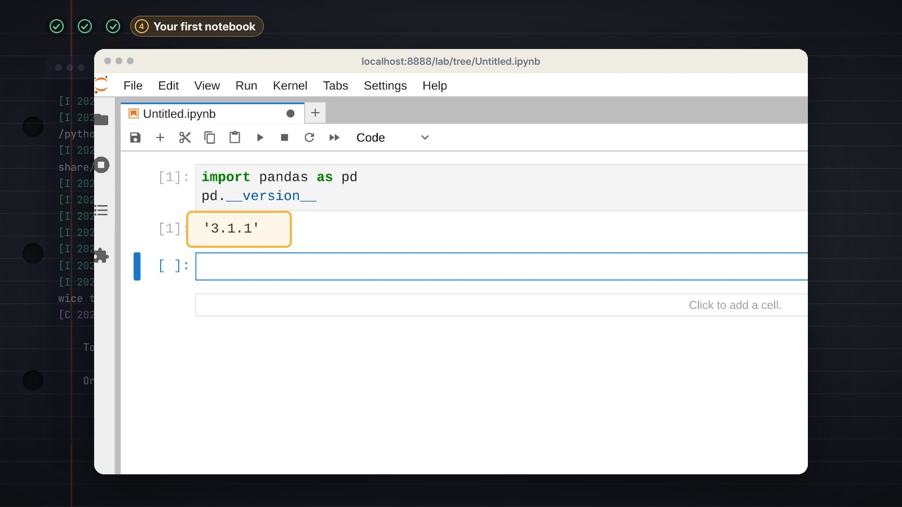

All four steps, done. Your computer is ready.

---

## Next time

Two lines (on Windows, in Miniforge Prompt):

```sh
conda activate ml
jupyter lab
```

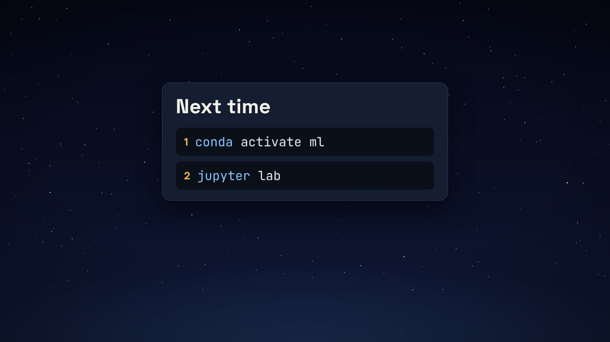

## When something goes wrong

**The terminal says conda isn't found** (`'conda' is not recognized`,
`zsh: command not found: conda`, `bash: conda: command not found`):

- **Windows:** use **Miniforge Prompt** from the Start menu, not Command
  Prompt or PowerShell.
- **Mac or Linux:** open a new terminal. If it still isn't found, run this,
  then open a new terminal again:

  ```sh
  ~/miniforge3/bin/conda init --all
  ```

**Python says `No module named 'pandas'`:** you're outside the box (the line
starts with `(base)`). Step in first:

```sh
conda activate ml
```

## The quick way

With conda installed (step 1), [environment.yml](environment.yml) builds
the box in one go, with the exact versions this episode used. Download it,
then in the folder you saved it to:

```sh
conda env create -f environment.yml
conda activate ml
```

That builds the same `ml` box: the same versions on Windows, both kinds of
Mac and Linux. If you already made `ml` by following the steps above, you
don't need it.

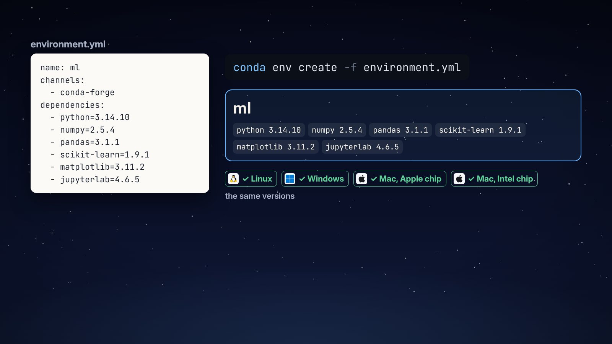

## The versions in the video

Recorded on 5 November 2026: conda 26.9.4, Python 3.14.10, NumPy 2.5.4,
pandas 3.1.1, scikit-learn 1.9.1, matplotlib 3.11.2 and JupyterLab 4.6.5.
`conda install` picks the newest that fit, so yours may be newer;
`environment.yml` gives exactly these.
