# Episode 1: Who survived the Titanic?

The video: [**Machine learning from scratch**, episode 1](https://youtu.be/0ZwCM-_6YYU), on
[MP_Studio's YouTube channel](https://www.youtube.com/@mpstudioapp).

Every cell from the video, in order, with what it does and screenshots. You
load the real passenger list, explore it with pandas, get it ready for a
model, teach a decision tree to guess who survived, and make sure it doesn't
just memorize. The whole notebook, with its outputs, is
[titanic.ipynb](titanic.ipynb).

**Before you start:** your computer is set up as in [episode 0](../00-setup)
(conda and the `ml` box). No `ml` box yet? With conda installed,
[environment.yml](environment.yml) builds it: `conda env create -f
environment.yml`. You also need the internet the first time: the data comes
from OpenML.


On April 10, 1912, the Titanic left Southampton for New York on its first
voyage. On April 14, close to midnight, it hit an iceberg, and less than
three hours later it sank. About 2,200 people were on board; its 20
lifeboats had room for 1,178. About 1,500 died. Who got a place in a boat:
was it luck, or is there a pattern?

---

## Step 1: Meet the passengers

Open your terminal, step into the box and start JupyterLab:

```sh
conda activate ml
jupyter lab
```

Under **Notebook**, click **Python 3 (ipykernel)** for a new notebook.

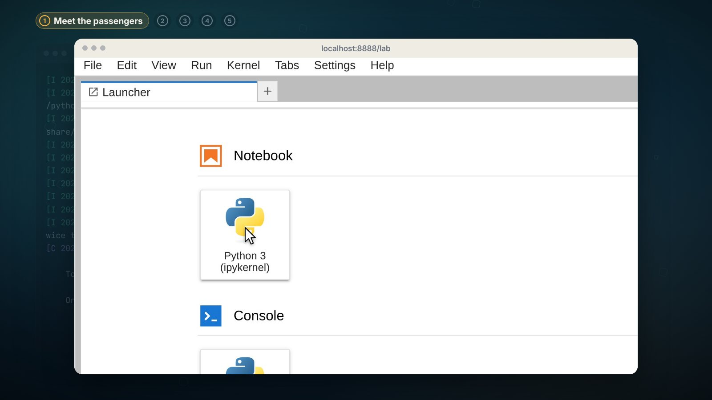

A notebook mixes text and code, in cells. Give it a title: press **Esc**,
then **M**, to turn the cell into a text (Markdown) cell, and type a hash and
a space for a heading. **Shift + Enter** runs a cell.

```markdown
# Who survived the Titanic?
```

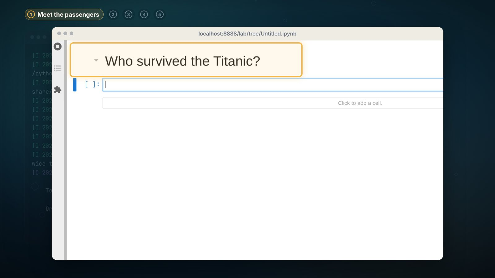

The next cell loads the data. `import pandas as pd` brings in pandas, the
library for tables, under the short name `pd`. From scikit-learn, the
machine learning library, `fetch_openml` downloads datasets from
[OpenML](https://www.openml.org), a free online library of datasets.

```python
import pandas as pd
from sklearn.datasets import fetch_openml

df = fetch_openml("titanic", version=1, as_frame=True,
                  parser="liac-arff").frame
df.shape
```

`as_frame=True` asks for a data frame, pandas' word for a table.
`parser="liac-arff"` picks the file reader that works with pandas 3:
scikit-learn 1.9.1's default reader stops with a `TypeError` there.
`df.shape` gives the table's size: `(1309, 14)`, 1,309 rows (one per
passenger) and 14 columns.

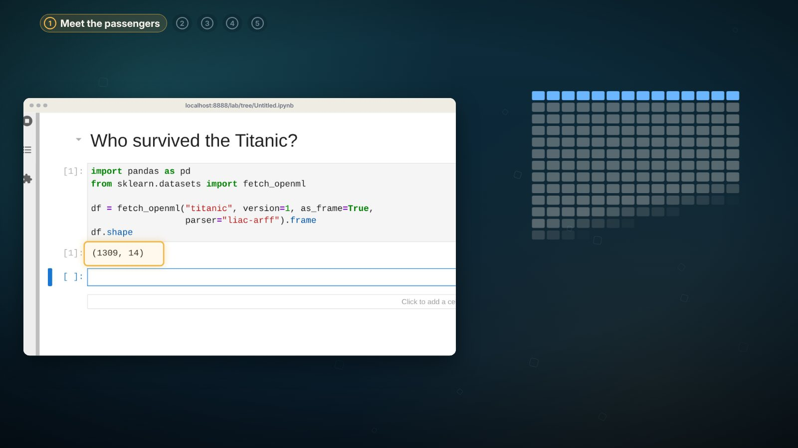

`head` shows the first five rows. Six of the columns fit on the screen:

```python
df[["name", "sex", "age", "pclass", "fare", "survived"]].head()
```

Each row is one passenger, and each column is one fact about them. The first
is Miss Elisabeth Walton Allen, 29, in first class; she paid £211.34 and
survived. `survived` is 1 if they lived and 0 if they didn't: the answer we
want to predict.

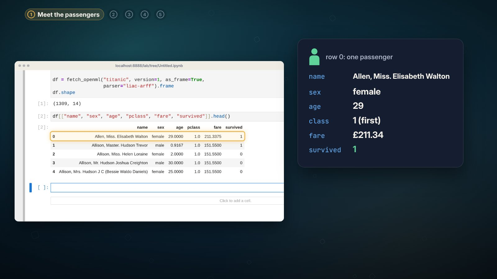

All 14 facts about her: `iloc` picks a row by its position, counting from
zero.

```python
df.iloc[0]
```

| Column | What it holds |
| --- | --- |
| `pclass` | the ticket class: 1, 2 or 3 |
| `survived` | 1 if they lived, 0 if they didn't |
| `name`, `sex`, `age` | who they were |
| `sibsp` | siblings and spouses on board with them |
| `parch` | parents and children on board with them |
| `ticket`, `fare`, `cabin` | the ticket number, its price in British pounds, the cabin |
| `embarked` | where they came aboard: S Southampton, C Cherbourg, Q Queenstown |
| `boat` | the lifeboat they left in |
| `body` | the number given to a body that was found |
| `home.dest` | where they lived, and where they were going |

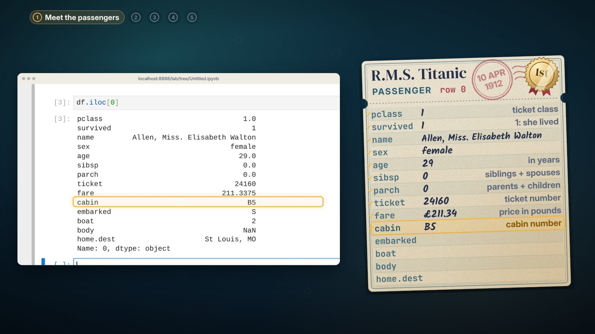

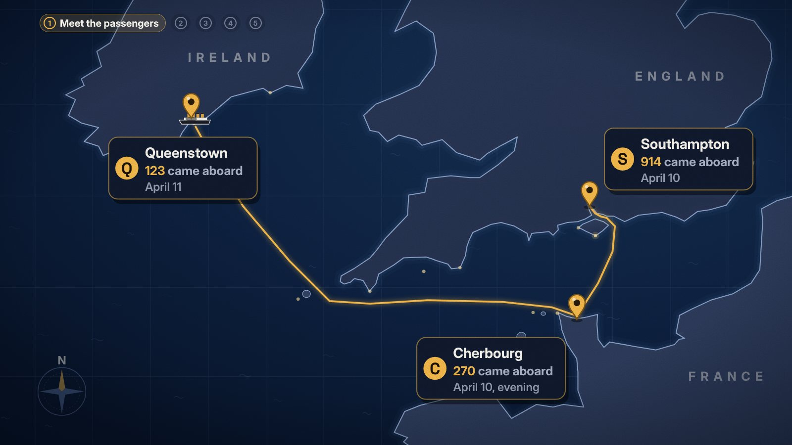

Not every passenger has every fact. `isna` marks each gap, and `sum` counts
the gaps in each column:

```python
df.isna().sum()
```

263 ages are missing, one fare and two ports. The cabin is missing for
1,014 passengers, almost everyone in second and third class. `boat` and
`body` have gaps for a reason: most passengers never got into a lifeboat,
and most bodies were never found.

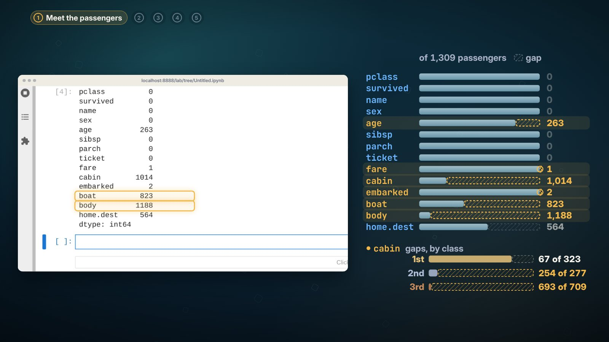

---

## Step 2: Ask the data

How many survived?

```python
df["survived"].value_counts()
```

809 zeros and 500 ones. A text cell can hold math, written in LaTeX between
dollar signs:

```markdown
The share who survived: $p = \frac{500}{1309} \approx 0.38$
```

38 in every 100 passengers survived.

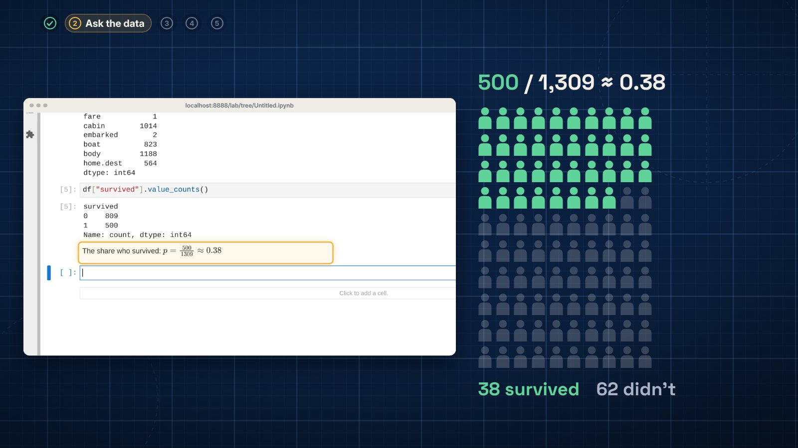

pandas reads `survived` as categories, not numbers; `astype(int)` turns it
(and the class) into whole numbers, so we can do math with it. `groupby`
splits the passengers into groups, and `mean` takes each group's average.

```python
df["survived"] = df["survived"].astype(int)
df["pclass"] = df["pclass"].astype(int)
df.groupby("sex")["survived"].mean()
```

The average of zeros and ones is the share of ones: the first five
passengers have survived 1, 1, 0, 0 and 0, an average of 2 ÷ 5 = 0.4, and 2
in 5 of them survived. So the mean of `survived` is the share who survived.
Women: 73 in 100. Men: 19.

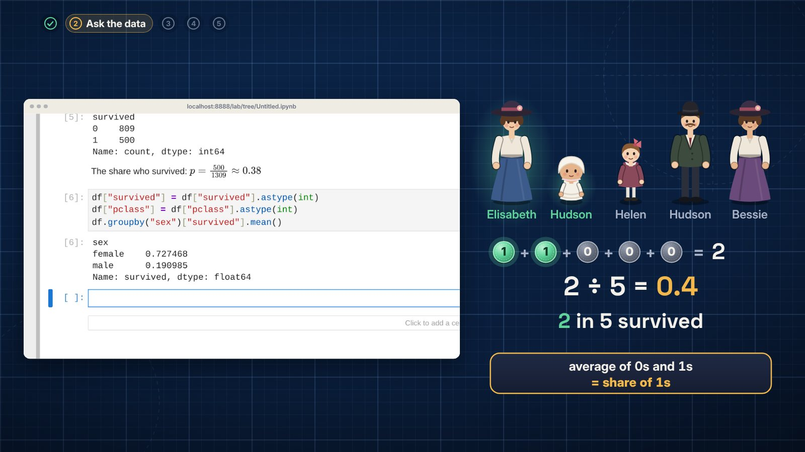

Why such a gap? As the ship sank, the captain ordered the crew to put women
and children into the boats first. On one side of the ship an officer let
only women and children in; on the other, men could take a seat when no
women were waiting.

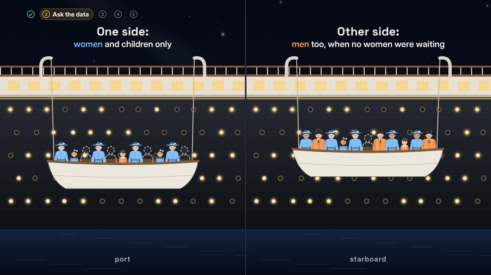

What about the children? A histogram of the ages, then the ages cut into
groups:

```python
df["age"].plot.hist(bins=16, xlabel="age");
```

```python
ages = pd.cut(df["age"], [0, 10, 20, 40, 60, 80])
df.groupby(ages)["survived"].mean()
```

Children up to 10: 58 in 100 survived. The groups up to 60: about 40. Over
60: 24. Children did get a better chance; age matters, but much less than
sex.

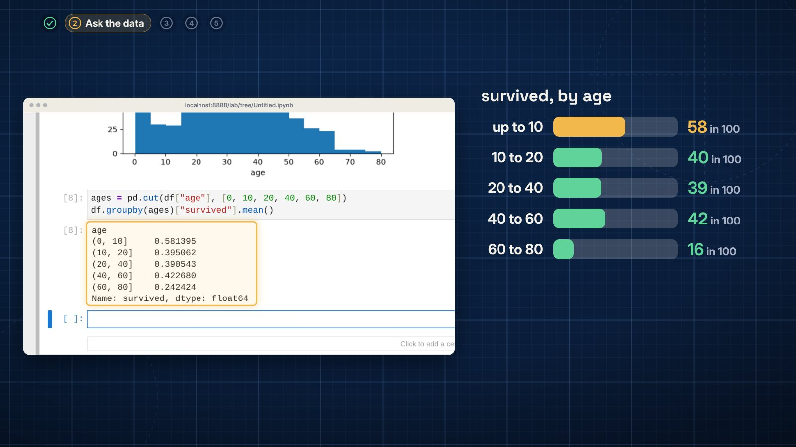

By ticket class: 62 in 100 survived in first class, 43 in second, 26 in
third.

```python
df.groupby("pclass")["survived"].mean()
```

Part of the reason is where they slept: the lifeboats were on the boat deck,
at the very top of the ship, and third class slept at the far ends of the
ship, many of them deep below, the farthest from the lifeboats.

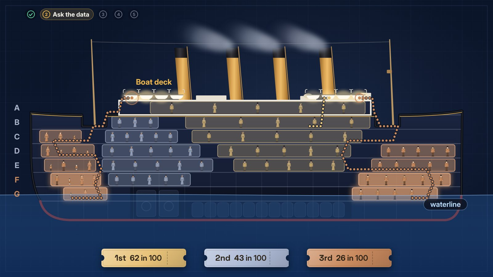

Class and sex together, in a chart:

```python
chart = df.groupby(["pclass", "sex"])["survived"].mean().unstack()
chart.plot.bar(ylabel="share who survived");
```

Almost every woman in first and second class survived; in third class, only
half did. Men in second and third class: about 15 in 100.

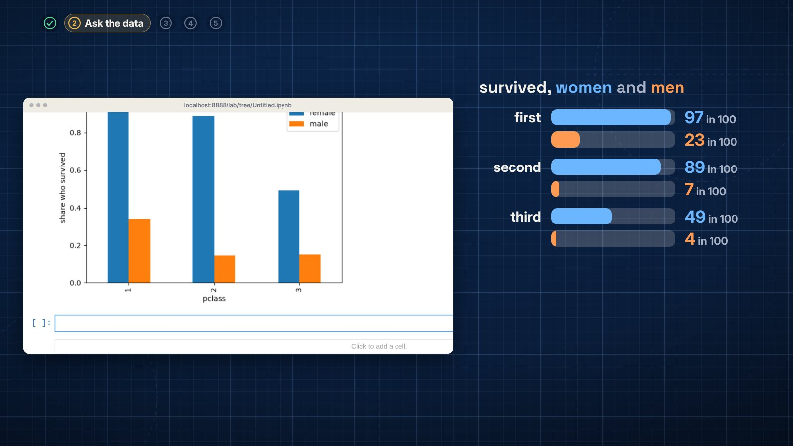

One more clue, family: a new column with everyone related to them on board.

```python
df["family"] = (df["sibsp"] + df["parch"]).astype(int)
df.groupby("family")["survived"].mean().plot.bar(ylabel="share who survived");
```

Alone: 30 in 100 survived. With one to three relatives: more than half. With
four or more: 18 in 100, and 69 of those 82 people traveled in third class.

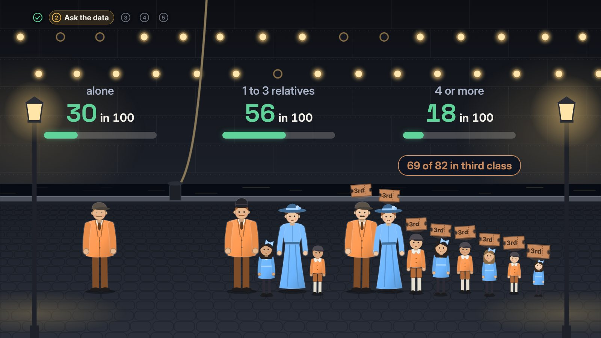

---

## Step 3: Get the data ready

We could write the rules ourselves (if it's a woman, say survived), but every
clue adds more rules, and we'd have to guess where each line goes. Machine
learning turns it around: we show the computer examples, with their answers,
and it finds the rules itself. The facts it looks at are the **features**;
the answer it learns is the **target**.

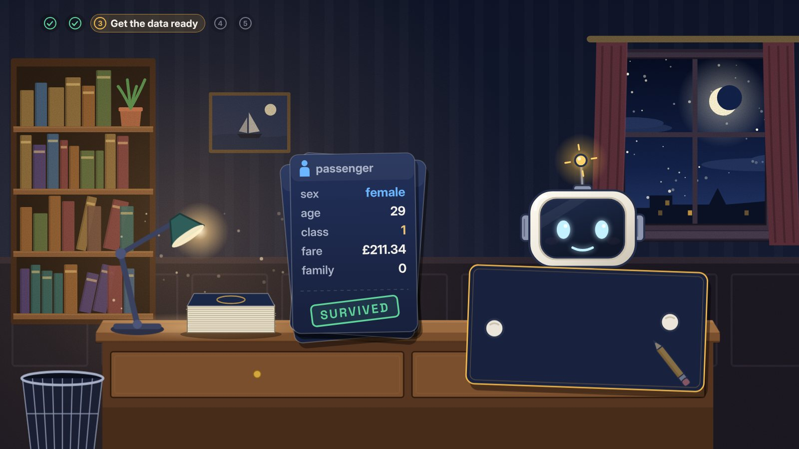

A model only reads numbers. `X`, the features, becomes a table of numbers:
`female` is 1 for a woman and 0 for a man; the class and family are numbers
already. `fillna` fills the gaps: each missing age gets the median age, 28,
the middle of all the ages (half the passengers are younger, half older),
and the one missing fare the median fare. `y`, the target, is `survived`.

```python
X = pd.DataFrame({
    "female": (df["sex"] == "female").astype(int),
    "pclass": df["pclass"],
    "age": df["age"].fillna(df["age"].median()),
    "fare": df["fare"].fillna(df["fare"].median()),
    "family": df["family"],
})
y = df["survived"]
X.head()
```

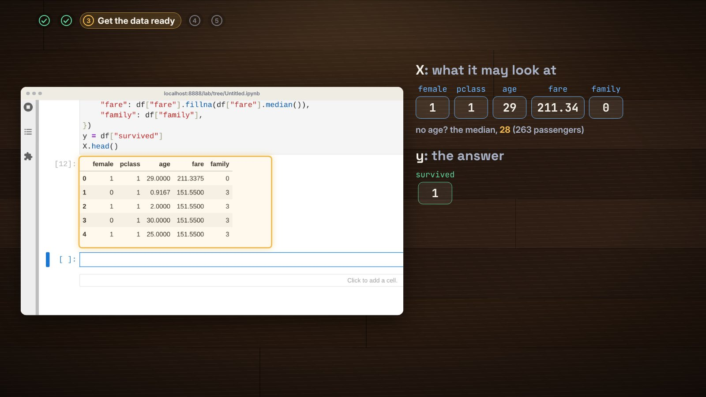

Some columns stay out. Names, tickets and home towns are text, different for
nearly everyone, and the cabin is mostly missing. And `boat` and `body` would
be cheating: 98 in 100 passengers with a lifeboat number survived, and nobody
with a body number did. Nobody knew those numbers before the ship sank; a
model may only use what was known before the answer.

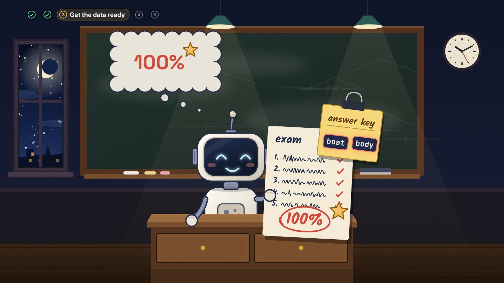

---

## Step 4: Teach a model

Hide a quarter of the passengers for a test, like an exam with new
questions: with only the questions you practiced, you could pass by
memorizing. `random_state=0` makes the shuffle the same every time, so you
get the same numbers as the video.

```python
from sklearn.model_selection import train_test_split

X_train, X_test, y_train, y_test = train_test_split(
    X, y, test_size=0.25, random_state=0)
len(X_train), len(X_test)
```

`(981, 328)`: 981 to learn from (the training set), 328 for the test.

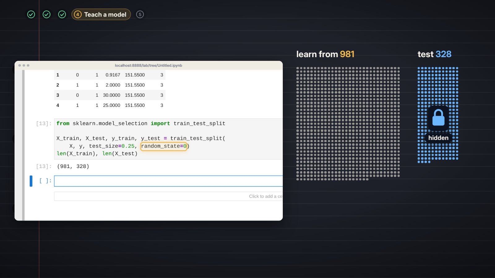

A decision tree plays a game of yes-or-no questions: each passenger starts at
the top, and every answer sends them left or right, down to a leaf that holds
the guess. To pick a question, the tree tries every one and keeps the one
that splits the passengers into the purest groups.

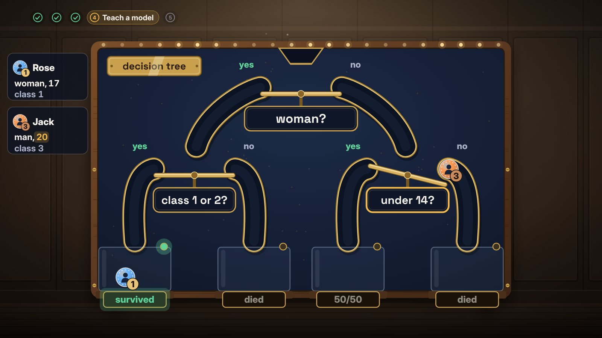

Purity has a formula, the Gini impurity, where $p$ is the share who survived
in a group:

```markdown
Gini impurity: $G = 1 - p^2 - (1 - p)^2$
```

It is the chance that two passengers picked at random from the group had
different fates: 0 when they all shared the same fate, 0.5 at most.

```python
def gini(answers):
    p = answers.mean()
    return 1 - p**2 - (1 - p)**2

women = X_train["female"] == 1
print(round(gini(y_train), 3))
print(round(gini(y_train[women]), 3), round(gini(y_train[~women]), 3))
```

All 981 training passengers: 0.475. Split by sex: the women 0.392 and the men
0.310, 0.340 weighted by the size of each group. The best question on class
gets to 0.436, on fare 0.441, on family 0.461 and on age 0.470, so the first
question is: is the passenger a woman? Then the tree does the same inside
each group, again and again.

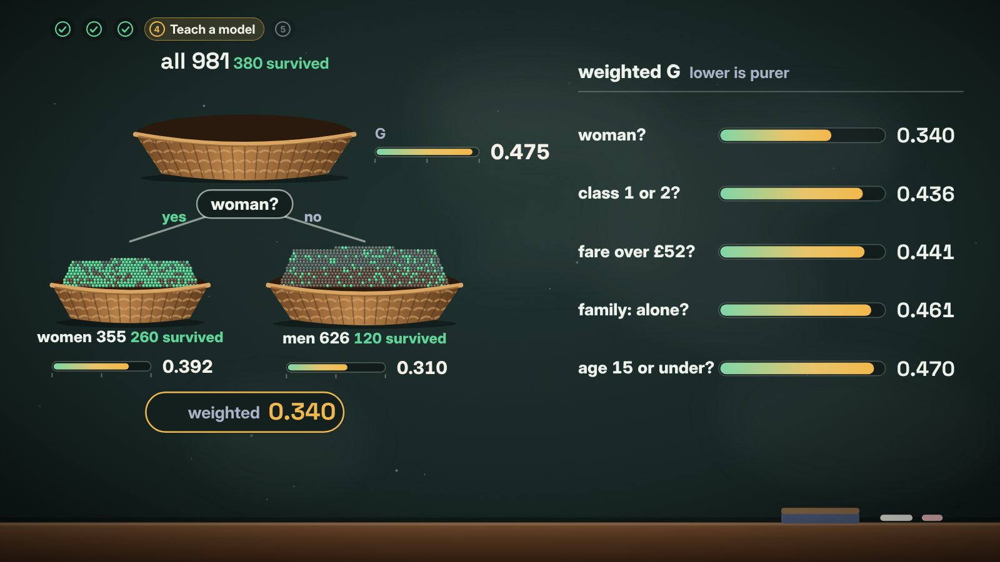

Train it. `max_depth=3` allows at most three questions in a row; `fit` is
where the learning happens.

```python
from sklearn.tree import DecisionTreeClassifier

tree = DecisionTreeClassifier(max_depth=3, random_state=0)
tree.fit(X_train, y_train)
```

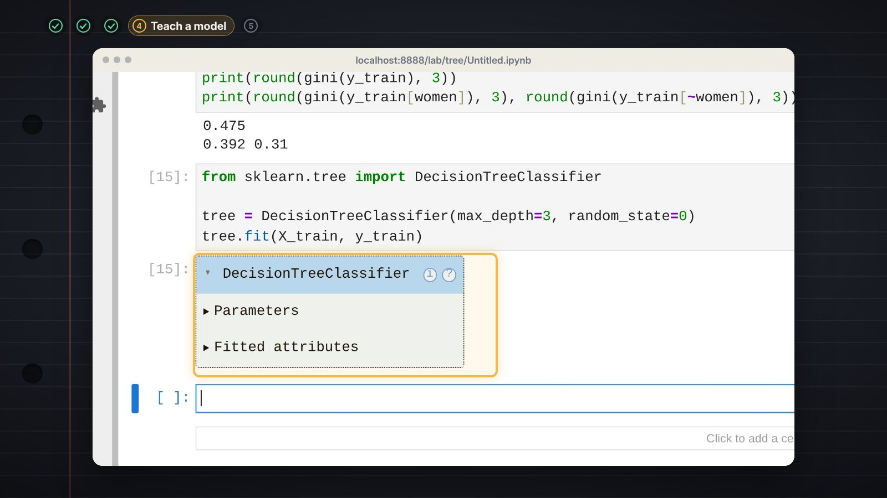

`predict` asks it about the test passengers, ones it has never seen; the
first five are all right. `score` checks all 328 at once.

```python
guess = tree.predict(X_test)
pd.DataFrame({"guess": guess, "truth": y_test}).head()
```

```python
tree.score(X_test, y_test)
```

```markdown
$\text{accuracy} = \dfrac{\text{right answers}}{\text{all answers}}$
```

`0.814`: 267 of the 328 right, 81 in 100.

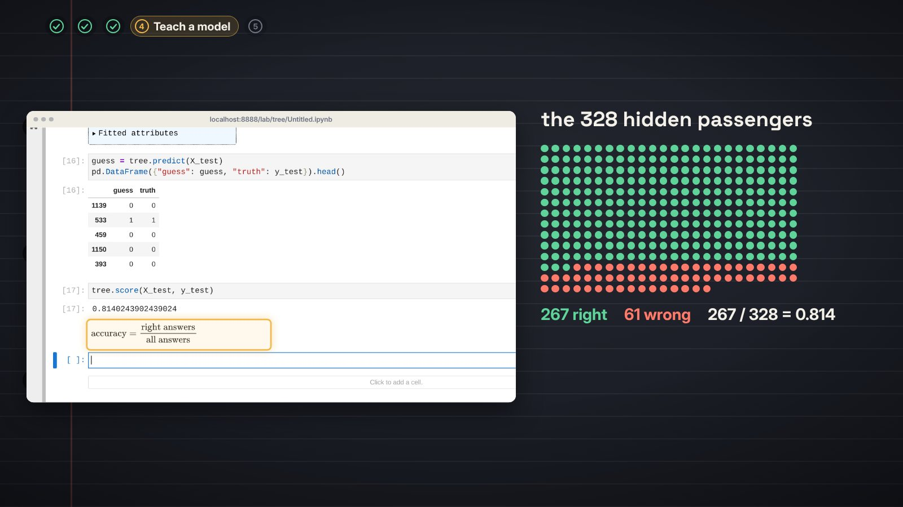

Which ones did it get wrong?

```python
from sklearn.metrics import confusion_matrix

confusion_matrix(y_test, guess)
```

```
array([[182,  26],
       [ 35,  85]])
```

182 died and the tree said died; 85 survived and it said survived. 26 it
thought would survive died, and it missed 35 survivors. Its mistakes follow
its rule: 24 of the 26 are women who died, and 33 of the 35 are men who
survived.

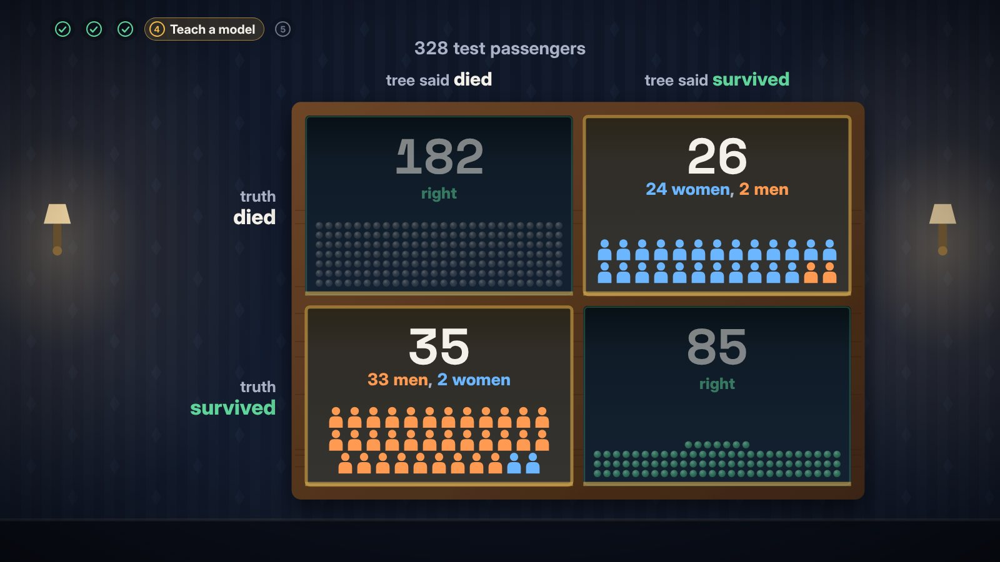

Is 81 in 100 good? Two simple guesses on the same test passengers:

```python
everyone_died = (y_test == 0).mean()
women_survive = (X_test["female"] == y_test).mean()
print(everyone_died.round(3), women_survive.round(3))
```

`0.634 0.777`: guessing everyone died is right 63 times in 100; guessing
women survive and men don't, 78. The tree beats both.

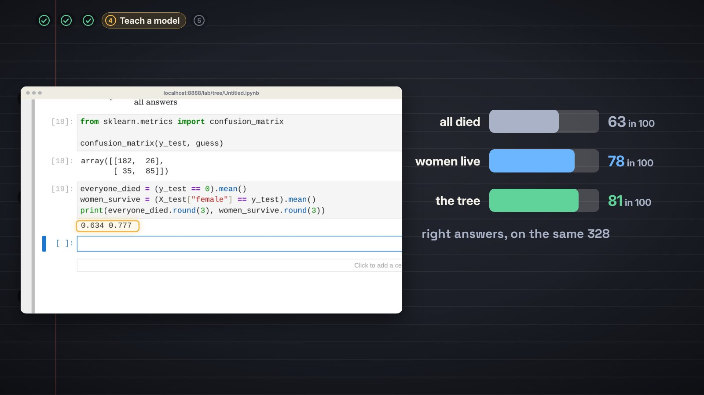

Read the tree:

```python
from sklearn.tree import export_text

print(export_text(tree, feature_names=list(X.columns)))
```

First: is the passenger a woman? For men, it asks the age: boys under 14 from
small families mostly survived (18 of 22 in the training set), boys from big
families didn't (1 of 16); older men in first class did better, but most of
them still died. For women, it asks the class: in first and second class
almost all survived; in third class the fare decides, and tickets over £23.35,
mostly big families on one ticket, saw only 1 of 23 of these women survive.
Sex, age, class and family: what we found by hand, the tree found by itself.

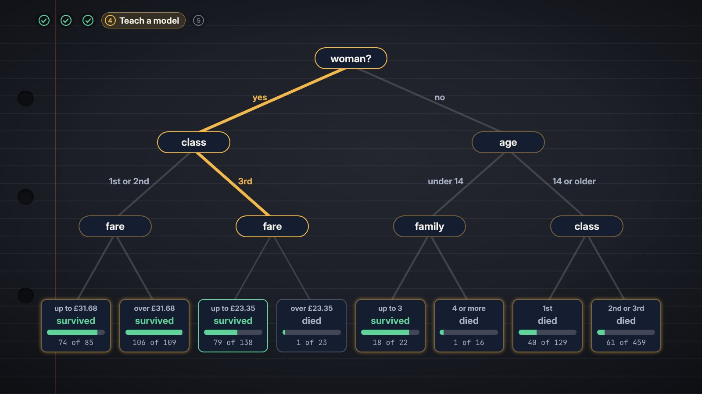

How much each feature helped:

```python
pd.Series(tree.feature_importances_, index=X.columns).round(2)
```

Sex does two thirds of the work; then class, then fare, family and age.

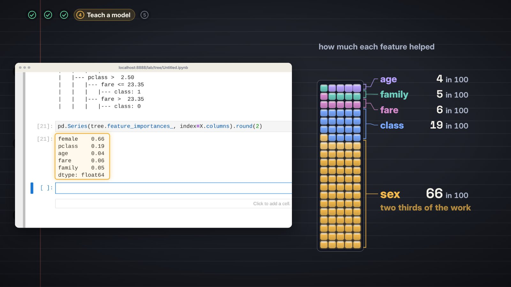

---

## Step 5: Don't let it memorize

A tree with no limit:

```python
deep = DecisionTreeClassifier(random_state=0)
deep.fit(X_train, y_train)
deep.score(X_train, y_train), deep.score(X_test, y_test)
```

`(0.971…, 0.762…)`: right 97 times in 100 on the passengers it learned from,
only 76 on the test. It grew 22 questions deep, with 232 leaves; half of them
hold two passengers or fewer. It learned the training passengers by heart,
quirks and all: that's **overfitting**.

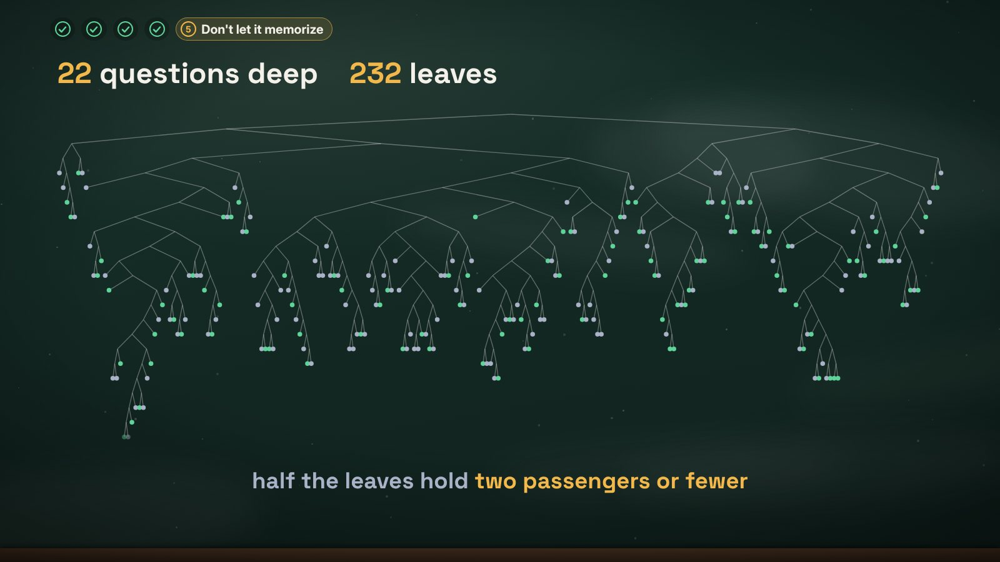

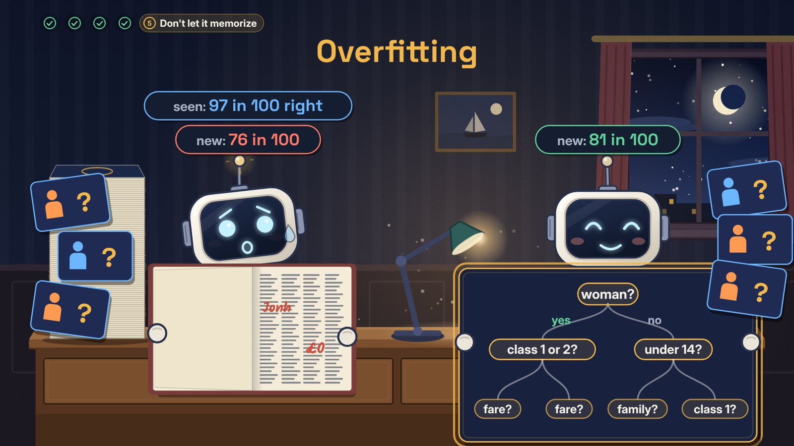

Every depth from 1 to 10:

```python
for depth in range(1, 11):
    t = DecisionTreeClassifier(max_depth=depth, random_state=0)
    t.fit(X_train, y_train)
    print(depth, round(t.score(X_train, y_train), 3),
          round(t.score(X_test, y_test), 3))
```

On the training set every extra question helps; on the test set the score
peaks at three questions, and deeper trees never beat it. One honest note:
choosing the depth by the test score is peeking at the exam. A later episode
fixes that with cross-validation.

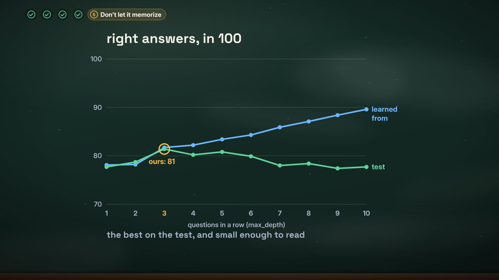

Last, two passengers it has never seen, Jack and Rose from the film: Jack,
20, alone in third class; Rose, 17, in first class with her mother. Their
fares are made up, typical for their class.

```python
people = pd.DataFrame({"female": [0, 1], "pclass": [3, 1], "age": [20, 17],
                       "fare": [7.0, 100.0], "family": [0, 1]},
                      index=["Jack", "Rose"])
tree.predict(people)
```

```python
tree.predict_proba(people).round(2)
```

`array([0, 1])`: Jack doesn't survive; Rose does. `predict_proba` gives the
chances: Jack lands in a leaf where 61 of 459 training passengers survived
(13 in 100), Rose in one where 106 of 109 did (97 in 100).

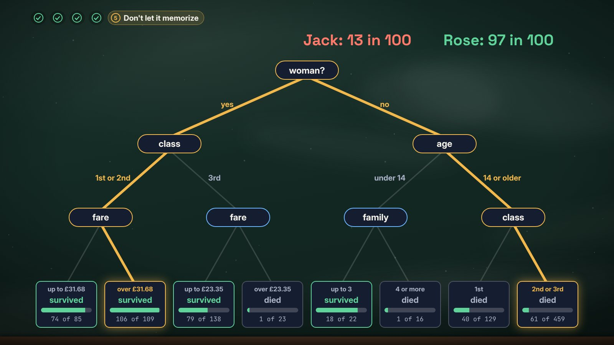

---

## The versions in the video

Recorded on 5 November 2026 on Linux, in the `ml` box from episode 0:
Python 3.14.10, pandas 3.1.1, scikit-learn 1.9.1 and matplotlib 3.11.2.
The data is OpenML's [Titanic dataset](https://www.openml.org/d/40945)
(version 1, license: public), by Frank E. Harrell Jr. and Thomas Cason
(Vanderbilt Biostatistics), from the Encyclopedia Titanica. It lists the
passengers only, not the crew.
