# Episode 2: What is this house worth?

The video: **Machine learning from scratch**, episode 2 (the link follows
when it is out), on
[MP_Studio's YouTube channel](https://www.youtube.com/@mpstudioapp).

Every cell from the video, in order, with what it does and screenshots. You
load 2,930 real house sales, explore them with pandas, get them ready, teach
a straight line and a decision tree to guess a price, and pick the better
one fairly, with cross-validation. The whole notebook, with its outputs, is
[houses.ipynb](houses.ipynb).

**Before you start:** your computer is set up as in [episode 0](../00-setup)
(conda and the `ml` box). No `ml` box yet? With conda installed,
[environment.yml](environment.yml) builds it: `conda env create -f
environment.yml`. You also need the internet the first time: the data comes
from OpenML.

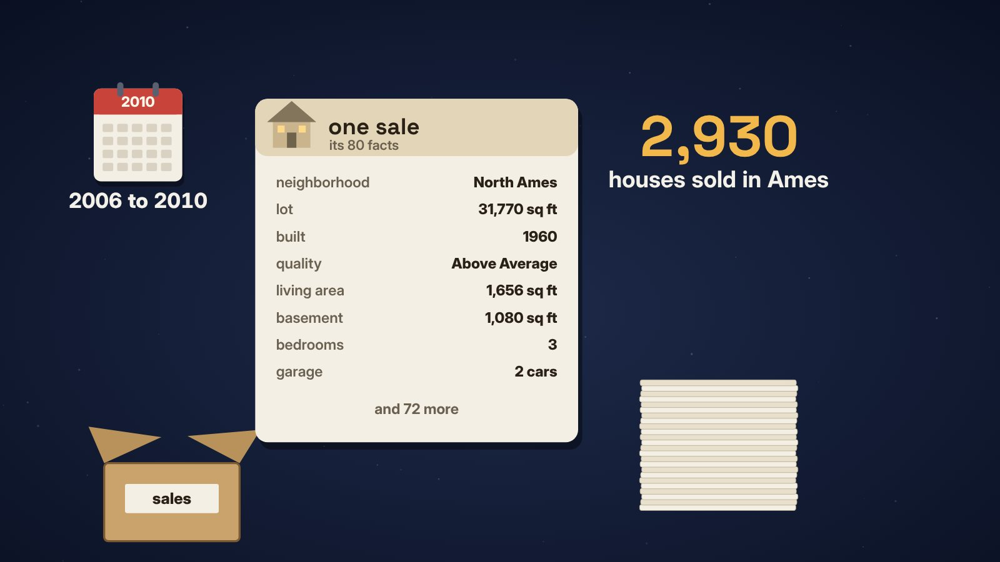

What is a house worth? Ask too much and nobody buys it; ask too little and
you lose money. A real estate agent compares similar houses that sold
nearby. Here a computer learns to do that, from the house sales of Ames, a
college town in Iowa: Dean De Cock, a statistics professor, got them from
the city's assessor for his students, as a fresher alternative to an old
list of house prices from 1970s Boston.

---

## Step 1: Meet the houses

Open your terminal, step into the box and start JupyterLab:

```sh
conda activate ml
jupyter lab
```

Under **Notebook**, click **Python 3 (ipykernel)** for a new notebook, and
give it a title: **Esc**, then **M**, makes a text (Markdown) cell, a hash
and a space make a heading, and **Shift + Enter** runs it.

```markdown
# What is this house worth?
```

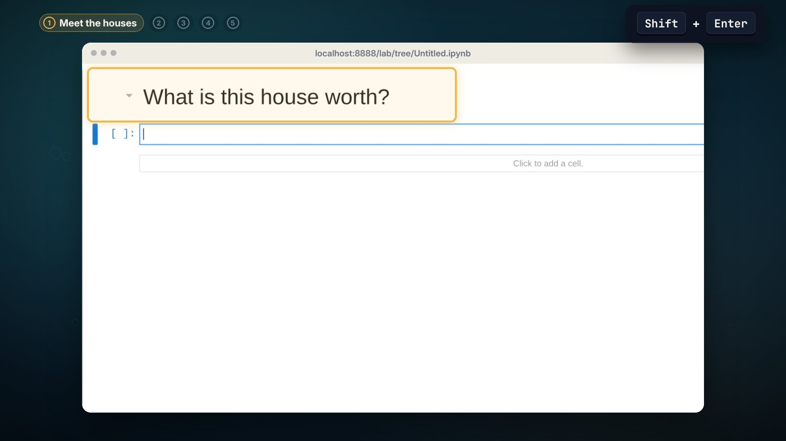

The next cell loads the data: pandas for tables, and `fetch_openml` from
scikit-learn to download a dataset from [OpenML](https://www.openml.org).

```python
import pandas as pd
from sklearn.datasets import fetch_openml

df = fetch_openml("ames_housing", version=1, as_frame=True).frame
df.shape
```

`ames_housing` is the professor's data, version 1, as a data frame. Unlike
the Titanic in episode 1, it needs no extra setting for pandas 3.
`(2930, 81)`: 2,930 rows, one per sale, and 81 columns, 80 facts about the
house and its price.

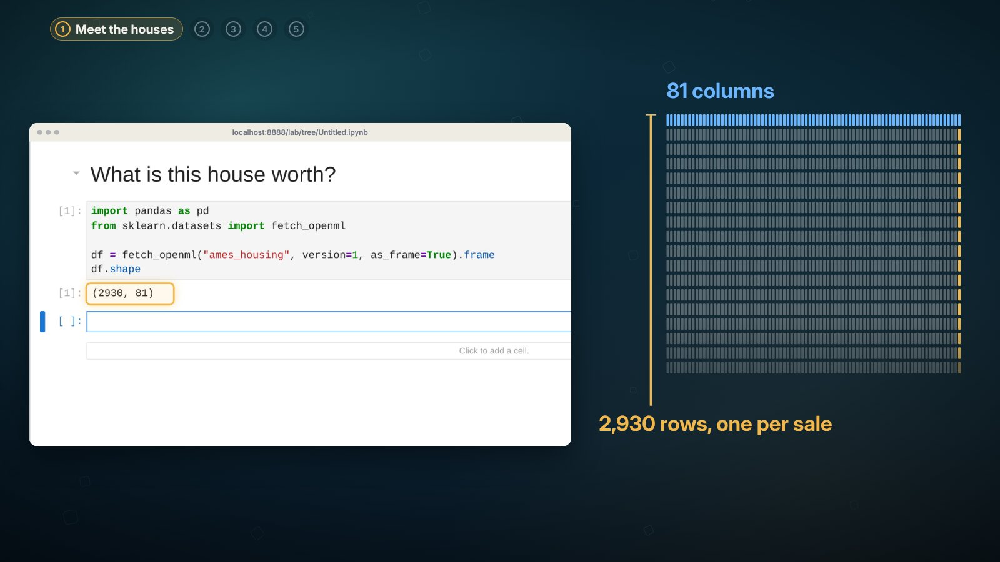

`head` shows the first five rows; four columns fit on the screen:

```python
df[["Neighborhood", "Year_Built", "Gr_Liv_Area", "Sale_Price"]].head()
```

The first house is in North Ames, built in 1960, with 1,656 square feet of
living space (about 154 square meters); it sold for 215,000 dollars. `Sale_Price`
is what we want to predict, and this time it's a number, not a yes or a no.

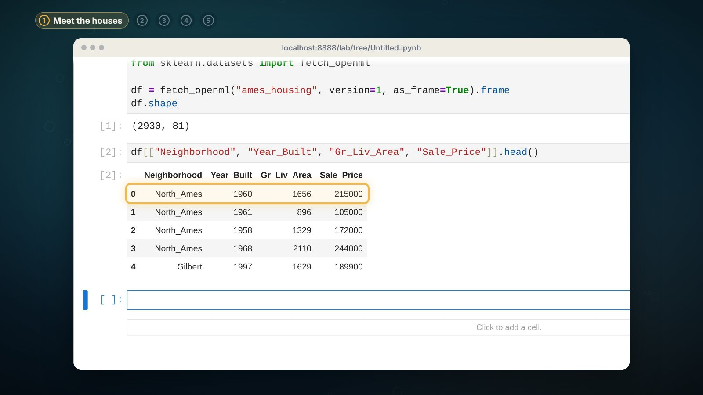

More facts about that house: a list of columns, and `loc`, which picks by
label (row 0, the columns in the list):

```python
facts = ["Neighborhood", "Lot_Area", "Year_Built", "Overall_Qual",
         "Gr_Liv_Area", "Total_Bsmt_SF", "Bedroom_AbvGr", "Full_Bath",
         "Garage_Cars", "Sale_Price"]
df.loc[0, facts]
```

| Column | What it holds |
| --- | --- |
| `Lot_Area` | the land it stands on, in square feet: 31,770 |
| `Overall_Qual` | the materials and finish, Very Poor to Very Excellent: Above Average |
| `Gr_Liv_Area` | the living area above the ground, in square feet |
| `Total_Bsmt_SF` | the basement, in square feet: another 1,080 |
| `Bedroom_AbvGr`, `Full_Bath`, `Garage_Cars` | three bedrooms, one full bathroom, a garage for two cars |

The other columns cover almost everything else: the roof, the heating, the
kitchen, the porch, even the pool and the fence.

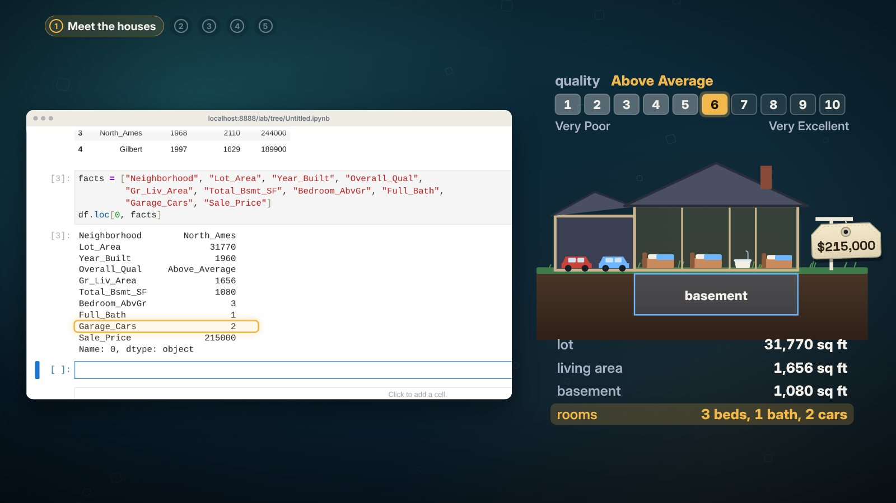

Each sale also has its place on the map. `plot.scatter` draws a dot per
house: `x` the longitude, `y` the latitude, `c` colors each dot by its
price, `cmap` picks the colors (dark purple cheap, yellow expensive), `s`
the dots' size and `figsize` the chart's.

```python
df.plot.scatter(x="Longitude", y="Latitude", c="Sale_Price",
                cmap="viridis", s=4, figsize=(8, 6));
```

The most expensive neighborhoods, Stone Brook and the two Northridges, are in
the north. The empty patch near the middle is Iowa State's campus.

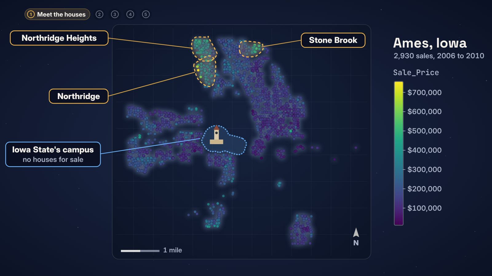

---

## Step 2: Ask the data

What does a house cost? `describe` sums up a column in eight numbers:

```python
df["Sale_Price"].describe()
```

2,930 prices, from 12,789 dollars to 755,000 dollars. The mean (the average) is about
181,000, dollars and the standard deviation (`std`, how far prices usually are from
it) about 80,000 dollars. The 25, 50 and 75 percent lines cut the houses into four
equal groups; the 50 percent line is the median, 160,000 dollars: half the houses
sold for less, half for more.

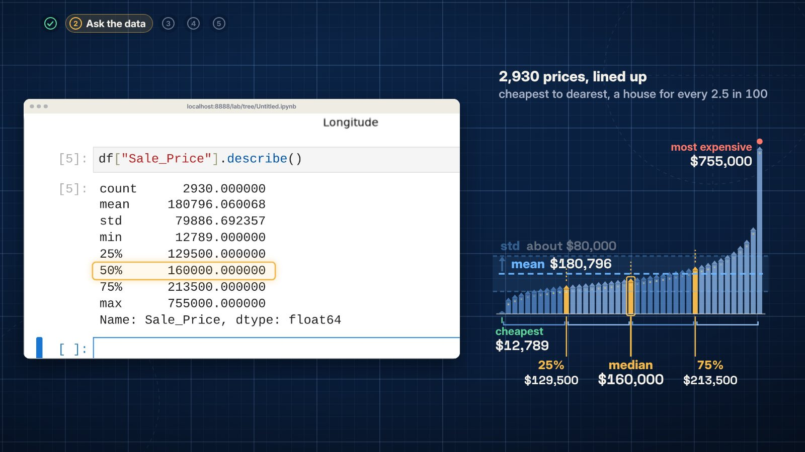

Why is the average higher than the median? A histogram sorts the prices into
40 bins:

```python
df["Sale_Price"].plot.hist(bins=40, xlabel="sale price ($)");
```

77 in 100 houses sold for between 100,000 dollars and 250,000, dollars but a long tail of
expensive houses stretches to the right and pulls the average up: 62 in 100
sold for less than the average. For a typical house, the median is the
better middle.

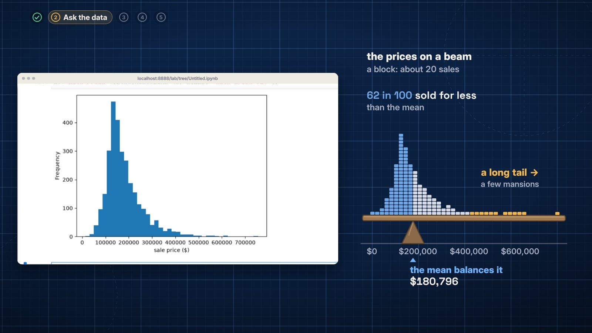

Does size matter? Each house at its living area (across) and price (up);
`alpha=0.3` makes the dots see-through:

```python
df.plot.scatter(x="Gr_Liv_Area", y="Sale_Price", alpha=0.3);
```

The bigger the house, the higher the price, but a few huge houses at the
bottom right sold cheap. Here they are:

```python
big = df[df["Gr_Liv_Area"] > 4000]
big[["Neighborhood", "Year_Built", "Sale_Condition", "Gr_Liv_Area",
     "Sale_Price"]]
```

Five houses over 4,000 square feet. Two in Northridge sold for 745,000 dollars and
755,000 dollars. Three in Edwards, over 4,600 square feet each, sold for less than
185,000 dollars: their sale condition is `Partial`, new houses not finished when
the assessor last valued them. The professor suggests leaving out every
house over 4,000 square feet; step 3 does.

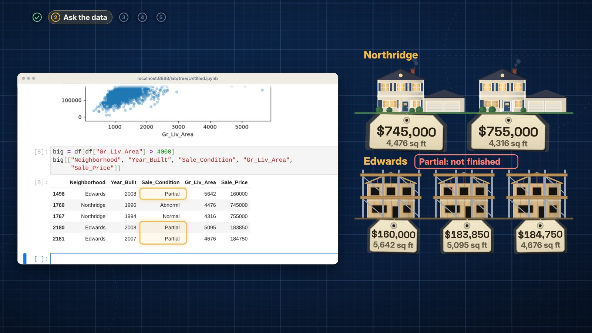

Quality is a word, so we turn it into a number: `order` lists the ten words
from worst to best, `zip` pairs each with 1 to 10, `dict` makes a lookup
table, and `map` looks up each house's word.

```python
order = ["Very_Poor", "Poor", "Fair", "Below_Average", "Average",
         "Above_Average", "Good", "Very_Good", "Excellent",
         "Very_Excellent"]
scores = dict(zip(order, range(1, 11)))
df["quality"] = df["Overall_Qual"].map(scores).astype(int)
df.groupby("quality")["Sale_Price"].median()
```

An average house, a 5: 133,000 dollars. A 10: almost 452,000 dollars. The steps
near the top are much taller: from 5 to 6 about 27,000 dollars, from 9 to 10 about
92,000 dollars.

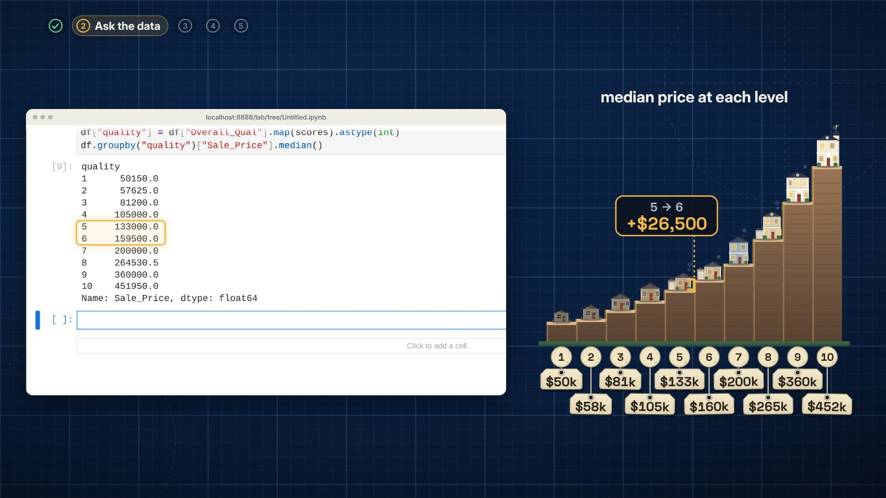

Location, location, location: the median price of each of the 28
neighborhoods, sorted, as bars lying down.

```python
places = df.groupby("Neighborhood")["Sale_Price"].median().sort_values()
places.plot.barh(xlabel="median price ($)", figsize=(6, 8));
```

In Meadow Village the median house sold for 88,250 dollars; in Stone Brook for
319,000, dollars more than three times as much.

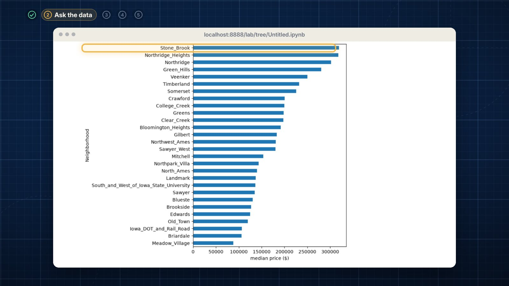

The sales run from 2006 to the middle of 2010, through the financial crisis
of 2008, but in Ames the median price barely moved: between 155,000 dollars and
165,000 dollars every year. So the year of the sale can stay out.

```python
df.groupby("Year_Sold")["Sale_Price"].median()
```

Which facts move with the price the most? `corr` computes the correlation of
every number column with the price, from -1 to 1 (near 1, the dots climb
along a straight line; near 0, no line at all; below 0, one goes down as the
other goes up):

```python
corr = df.corr(numeric_only=True)["Sale_Price"]
corr.sort_values(ascending=False).head(10)
```

Quality comes first at 0.80, then the living area at 0.71, the garage, the
basement, the first floor and the year it was built.

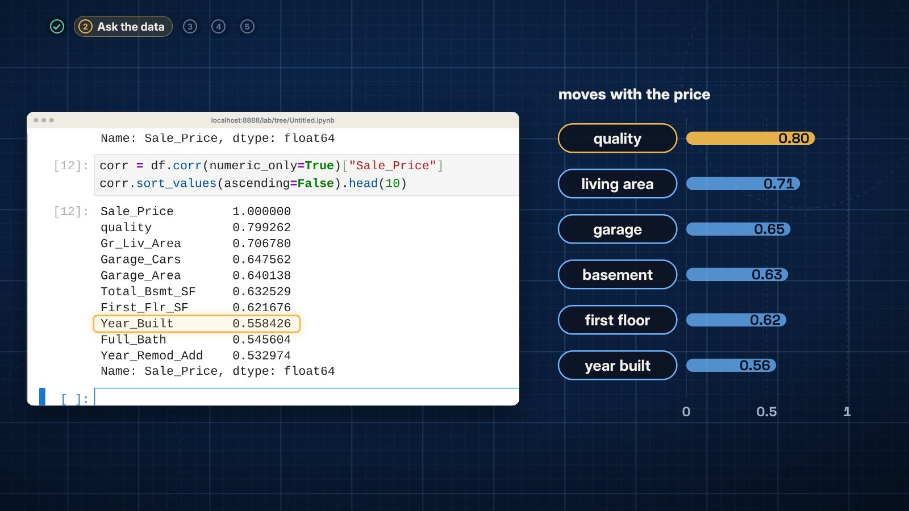

---

## Step 3: Get the data ready

Episode 1's model answered yes or no (classification). Today the answer is a
number, any amount: predicting a number is called regression. The features
are the facts the model looks at; the target is the answer it learns, here
the price.

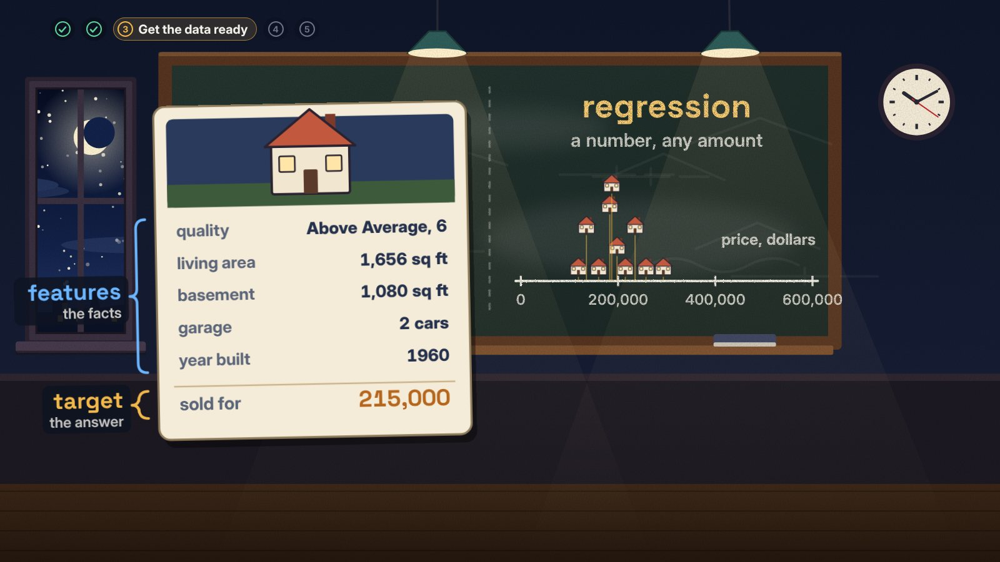

First, the five giants go, as the professor suggests. The model is for houses
up to 4,000 square feet.

```python
df = df[df["Gr_Liv_Area"] <= 4000]
len(df)
```

2,925 houses. The features, five columns from the top of the correlation
list, skipping the ones that say the same thing twice (`Garage_Area` moves
with `Garage_Cars`, and the first floor is part of the living area). The
neighborhood matters too, but it's a name, not a number, so it stays out
today. None of the five has a gap, and they're all numbers already.

```python
features = ["quality", "Gr_Liv_Area", "Total_Bsmt_SF", "Garage_Cars",
            "Year_Built"]
X = df[features]
y = df["Sale_Price"]
X.head()
```

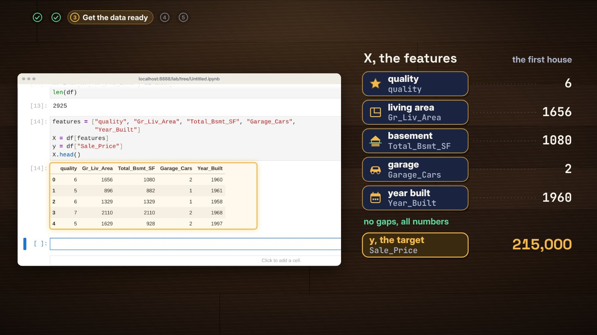

Like in episode 1, some houses are hidden from the model for the test: a
quarter of them, with `random_state=0` so you get the same numbers.

```python
from sklearn.model_selection import train_test_split

X_train, X_test, y_train, y_test = train_test_split(
    X, y, test_size=0.25, random_state=0)
len(X_train), len(X_test)
```

2,193 houses to learn from, and 732 for the test.

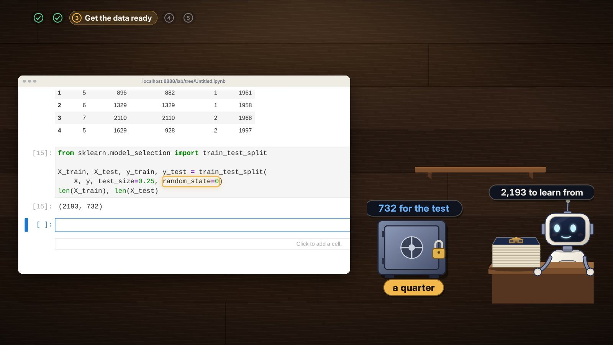

---

## Step 4: Teach a model

We try several models, from the simplest to the strongest, and let the data
choose: no model at all (the median for every house), a straight line
(linear regression) with one fact and then five, and a decision tree for
numbers. To choose, we need a score. With a price, a guess is almost never
exactly right, so the question is how far off it is: the mean absolute
error.

```markdown
Mean absolute error: $\text{MAE} = \dfrac{1}{n}\sum_{i=1}^{n} \lvert y_i - \hat{y}_i \rvert$
```

$y$ is the true price and $\hat{y}$ (y hat) the guess; the bars take the
size of the difference, without its sign. Add it up for all $n$ houses and
divide by $n$: on average, how many dollars off are we?

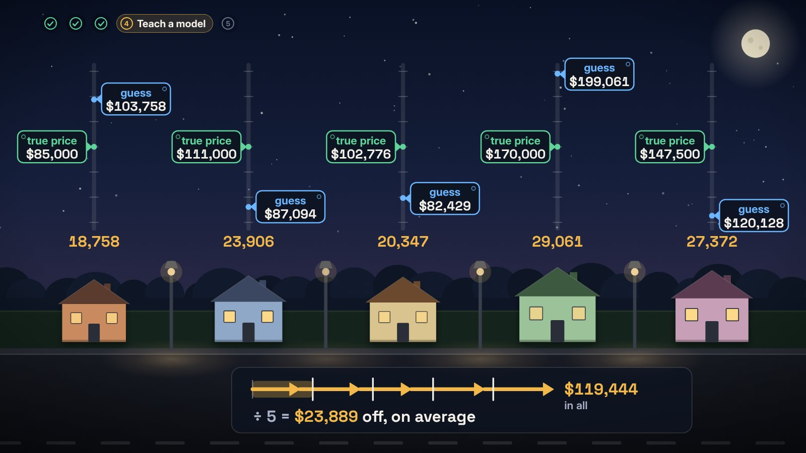

Before any model: every house costs the median of the training houses,
160,000 dollars.

```python
from sklearn.metrics import mean_absolute_error

middle = [y_train.median()] * len(y_test)
mean_absolute_error(y_test, middle)
```

Off by about 54,600 dollars on average. Any real model has to beat that.

A straight line through the size chart: the price is a number times the
living area, plus a starting amount. The double brackets keep the column a
table, which `fit` expects.

```python
from sklearn.linear_model import LinearRegression

line = LinearRegression()
line.fit(X_train[["Gr_Liv_Area"]], y_train)
line.coef_, line.intercept_
```

The slope (`coef_`): each extra square foot adds about 118 dollars. The line starts
(`intercept_`) at about 5,900 dollars. A house of 1,500 square feet: 118 × 1,500 +
5,900, about 182,000 dollars.

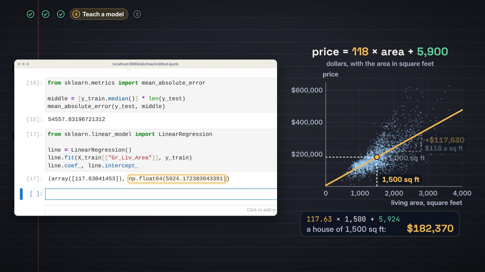

Which line is best? Least squares squares each miss and adds them up; the
best line has the smallest total. Squaring makes big misses count much
more (twice as big counts four times as much), and with squares the best
line can be worked out exactly, in one step: that's what `fit` does.

```markdown
Least squares: the line with the smallest $\sum_{i=1}^{n} (y_i - \hat{y}_i)^2$
```

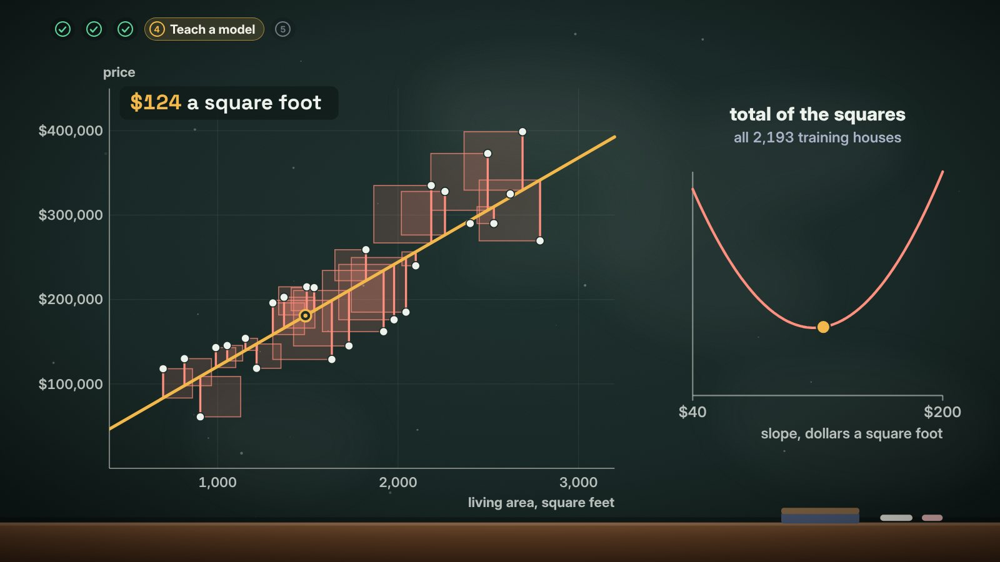

```python
mean_absolute_error(y_test, line.predict(X_test[["Gr_Liv_Area"]]))
```

Off by about 37,600, dollars much better than the median. But two houses of the
same size can be very different, so let's use all five facts:

```markdown
A line with five facts: $\hat{y} = b + w_1 x_1 + w_2 x_2 + w_3 x_3 + w_4 x_4 + w_5 x_5$
```

Each $x$ is a fact and each $w$ its weight, the dollars one more unit adds;
`fit` learns $b$ and the weights, again by least squares.

```python
model = LinearRegression()
model.fit(X_train, y_train)
pd.Series(model.coef_, index=features).round()
```

Each step up in quality adds about 19,400 dollars; each square foot of living area
56, dollars of basement 46 dollars; room for one more car about 11,000 dollars; each year newer
about 320 dollars. Each weight is the change in price when that one fact changes
and the others stay the same.

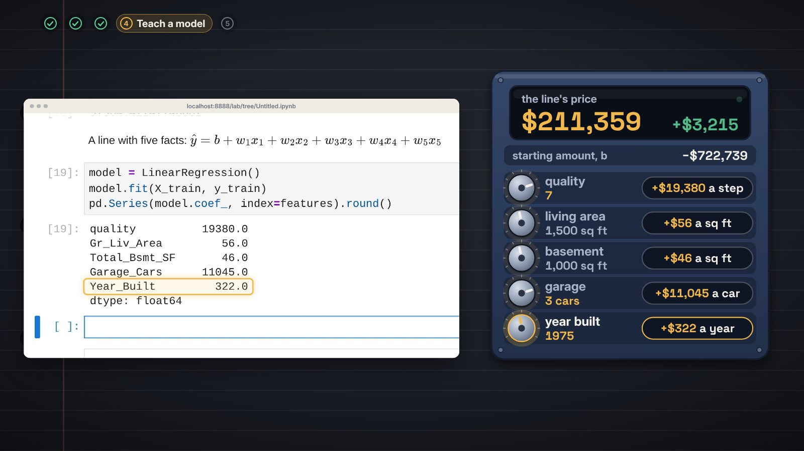

```python
guess = model.predict(X_test)
pd.DataFrame({"guess": guess.round(-3), "truth": y_test}).head()
```

```python
mean_absolute_error(y_test, guess)
```

Off by about 24,400 dollars. Where does it miss? Each test house at its true price
(across) and its guess (up); a perfect guess sits on the red line.

```python
ax = pd.DataFrame({"truth": y_test, "guess": guess}).plot.scatter(
    x="truth", y="guess", alpha=0.3)
ax.plot([0, 600000], [0, 600000], color="red");
```

Over 300,000 dollars it's off by about 52,000 dollars on average, and two tiny old houses
got a price below zero: a straight line doesn't know a price can't be
negative.

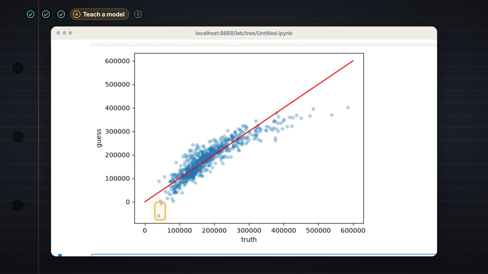

A decision tree works for numbers too. Each leaf holds a price, the average
of the training houses that land there, so it guesses in steps and never
below zero.

```python
from sklearn.tree import DecisionTreeRegressor

tree = DecisionTreeRegressor(max_depth=3, random_state=0)
tree.fit(X_train, y_train)
mean_absolute_error(y_test, tree.predict(X_test))
```

Three questions (quality first, then quality again, the living area and the
basement), 8 leaves from about 98,000 dollars to 472,000 dollars; off by about 29,800 dollars.
How does it pick a question? With prices, it measures how spread out a
group's prices are:

```markdown
How spread out a group's prices are: $\sqrt{\dfrac{1}{n}\sum_{i=1}^{n} (y_i - \bar{y})^2}$
```

```python
def spread(prices):
    return ((prices - prices.mean()) ** 2).mean() ** 0.5

round(spread(y_train))
```

All 2,193 training houses: 79,569 dollars. Now split them by quality, 7 and
below against 8 and up:

```python
fine = X_train["quality"] >= 8
round(spread(y_train[~fine])), round(spread(y_train[fine]))
```

The 1,829 simpler houses spread 48,290 dollars and the 364 finer ones 88,350
dollars; weighted by the size of each group, 56,925 dollars, the biggest drop
any question gives.
So the first question is about quality, and the tree does the same inside
each group, again and again.

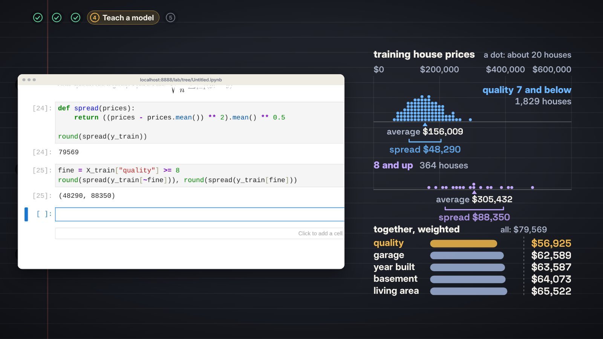

---

## Step 5: Pick without peeking

How many questions should the tree ask? Choosing on the test is peeking at
the exam. Cross-validation cuts the training houses into five folds; the
model learns from four and is tested on the fifth, five times in all, and
the average error is its score. The test houses stay locked away.


`cross_val_score` does the five rounds; it gives errors with a minus sign
(scikit-learn wants higher to be better), so `cv_error` flips it back.

```python
from sklearn.model_selection import cross_val_score

def cv_error(model):
    scores = cross_val_score(model, X_train, y_train, cv=5,
                             scoring="neg_mean_absolute_error")
    return round(-scores.mean())

for depth in [2, 4, 6, 8, 10, None]:
    t = DecisionTreeRegressor(max_depth=depth, random_state=0)
    print(depth, cv_error(t))
```

Two questions: about 34,100 dollars. Four: 26,200 dollars. Six: 23,100, dollars the best. Then it
gets worse, and with no limit 26,200 dollars: overfitting again.

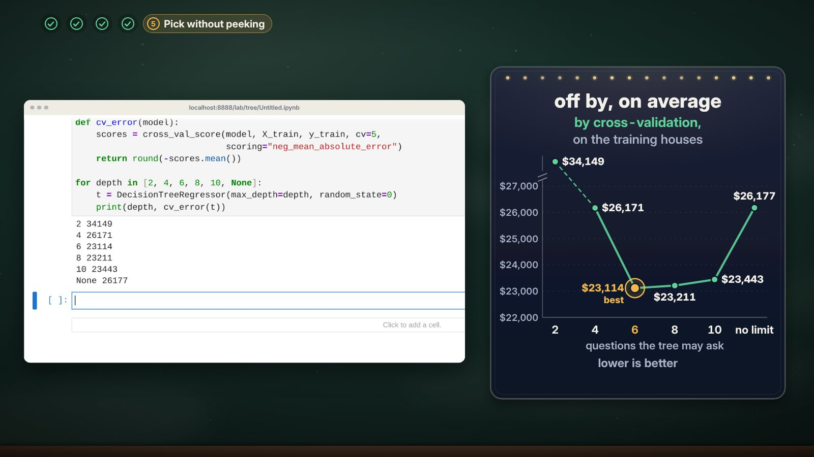

```python
cv_error(LinearRegression())
```

The line with five facts: about 23,800 dollars. The tree with six questions wins.
Now, and only now, the test is opened, once:

```python
final = DecisionTreeRegressor(max_depth=6, random_state=0)
final.fit(X_train, y_train)
mean_absolute_error(y_test, final.predict(X_test))
```

Off by 23,099 dollars on average, almost exactly what cross-validation promised:
about 14 in 100 of the price.

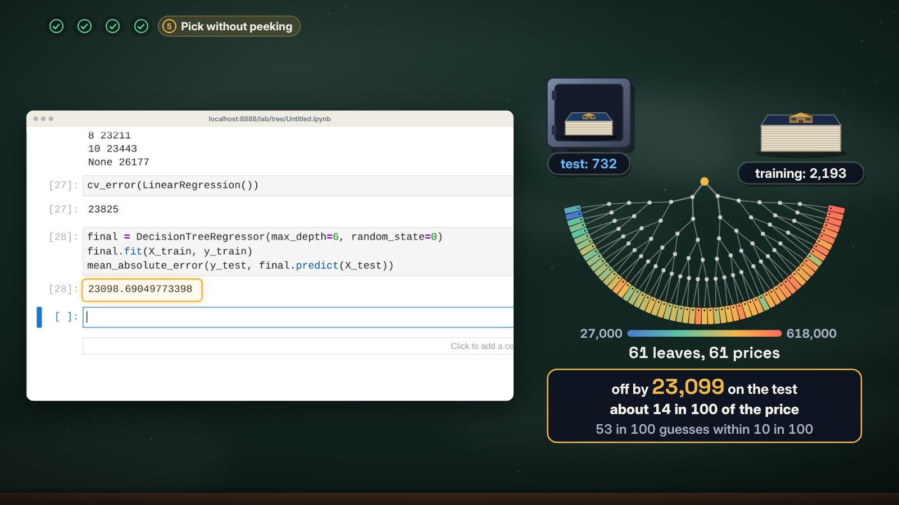

```python
pd.DataFrame({"line": guess[:5].round(-3),
              "tree": final.predict(X_test[:5]).round(-3),
              "truth": y_test[:5]})
```

What is a typical Ames house worth? Above Average (quality 6), 1,500 square
feet, a basement of 1,000, a two-car garage, built in 1975:

```python
ours = pd.DataFrame({"quality": [6], "Gr_Liv_Area": [1500],
                     "Total_Bsmt_SF": [1000], "Garage_Cars": [2],
                     "Year_Built": [1975]})
final.predict(ours).round(-3)
```

156,000, dollars give or take about 23,000 dollars. These houses sold in one town from
2006 to 2010: for a house somewhere else, or today, you'd need new data.

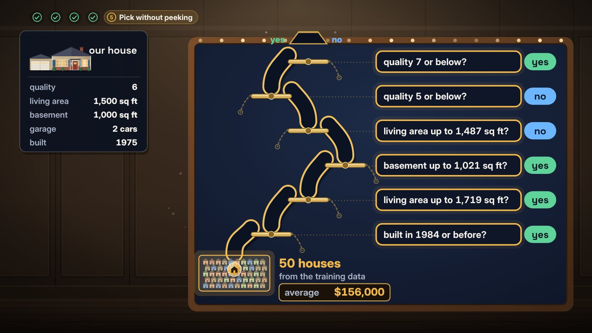

One tree is shaky: grow it again on a different four fifths of the training
houses, five times.

```python
for seed in range(5):
    some = X_train.sample(frac=0.8, random_state=seed)
    t = DecisionTreeRegressor(max_depth=6, random_state=0)
    t.fit(some, y_train[some.index])
    print(seed, t.predict(ours).round(-3))
```

154,000, 154,000, 186,000, 183,000 and 155,000: about 32,000 dollars apart, only
because each tree saw different houses. A later episode fixes that with a
team of trees.

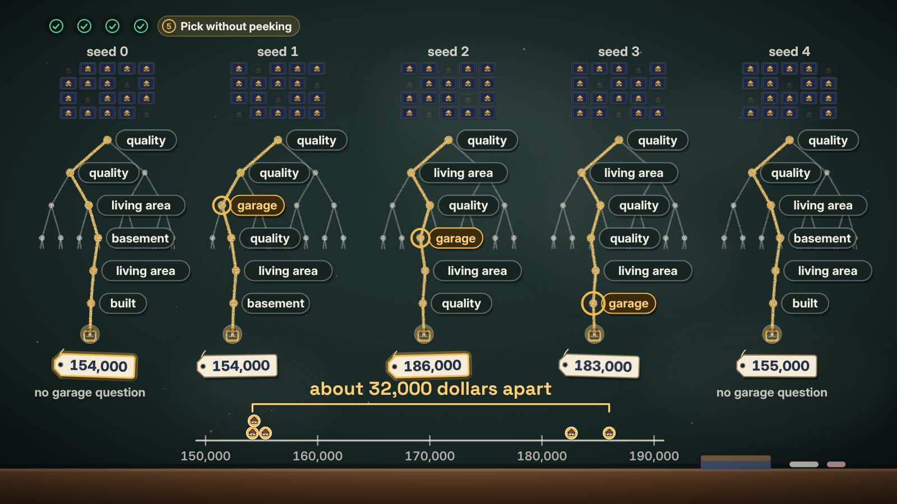

---

## The versions in the video

Recorded on 6 November 2026 on Linux, in the `ml` box from episode 0:
Python 3.14.10, pandas 3.1.1, scikit-learn 1.9.1 and matplotlib 3.11.2.
The data is OpenML's [ames_housing](https://www.openml.org/d/43926)
(version 1, license: public), the Ames Housing data compiled by Dean De Cock
for data science education ("Ames, Iowa: Alternative to the Boston Housing
Data as an End of Semester Regression Project", Journal of Statistics
Education 19(3), 2011), from the Ames City Assessor's Office, in the copy of
the R package AmesHousing, which adds each house's longitude and latitude.
