# Episode 3: Which penguin is it?

The video: **Machine learning from scratch**, episode 3 (the link follows
when it is out), on
[MP_Studio's YouTube channel](https://www.youtube.com/@mpstudioapp).

Every cell from the video, in order, with what it does and screenshots. You
load 344 real penguins from Antarctica, explore them with pandas, get them
ready, and teach a decision tree to tell three species apart. Then you open
the tree: you work out the math behind its questions by hand (the Gini
impurity, entropy and information gain), search every possible question
yourself, and prune the tree with cross-validation. The whole notebook, with
its outputs, is [penguins.ipynb](penguins.ipynb).

**Before you start:** your computer is set up as in [episode 0](../00-setup)
(conda and the `ml` box). No `ml` box yet? With conda installed,
[environment.yml](environment.yml) builds it: `conda env create -f
environment.yml`. You also need the internet the first time: the data comes
from OpenML.

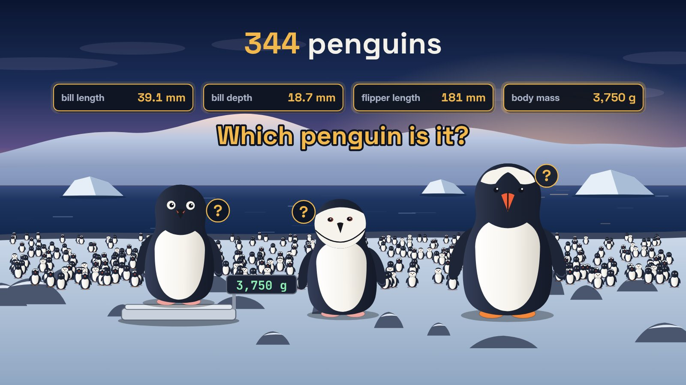

Which penguin is it? Off the Antarctic Peninsula, on Anvers Island, there's a
small American research station: Palmer Station. From 2007 to 2009, the
scientist Dr. Kristen Gorman and the Palmer Station team studied penguins on
three islands nearby: Biscoe, Dream and Torgersen. They measured three kinds.
The Adélie, named after a land in Antarctica that a French explorer named for
his wife, Adèle. The Chinstrap, with a thin black band under its chin, like
the strap of a helmet. And the Gentoo, the biggest of the three. For each
penguin, four numbers: how long its bill is, how deep, how long its flipper
is, and how much it weighs. From those four numbers alone, can a computer
tell which penguin it is?

---

## Step 1: Meet the penguins

Open your terminal, step into the box and start JupyterLab:

```sh
conda activate ml
jupyter lab
```

Under **Notebook**, click **Python 3 (ipykernel)** for a new notebook, and
give it a title: **Esc**, then **M**, makes a text (Markdown) cell, a hash
and a space make a heading, and **Shift + Enter** runs it.

```markdown
# Which penguin is it?
```

The next cell loads the data, like last time: pandas for tables, and
`fetch_openml` from scikit-learn to download a dataset from
[OpenML](https://www.openml.org).

```python
import pandas as pd
from sklearn.datasets import fetch_openml

df = fetch_openml("penguins", version=1, as_frame=True).frame
df.shape
```

`penguins` is the Palmer Station data, version 1, as a data frame.
`(344, 7)`: 344 rows, one for each penguin, and 7 columns.

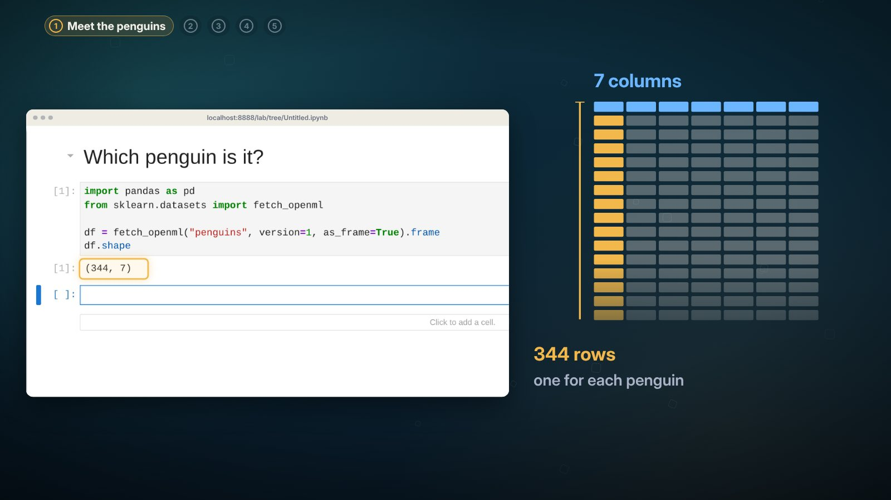

`head` shows the first five rows:

```python
df.head()
```

Each penguin has its species, its island, four measurements and its sex:

| Column | What it holds |
| --- | --- |
| `species` | Adelie, Chinstrap or Gentoo: the answer we want |
| `island` | Biscoe, Dream or Torgersen |
| `culmen_length_mm` | how long the bill is, in millimeters |
| `culmen_depth_mm` | how tall the bill is at its base, in millimeters |
| `flipper_length_mm` | how long the flipper is, in millimeters |
| `body_mass_g` | how much the penguin weighs, in grams |
| `sex` | MALE or FEMALE |

The culmen is the ridge along the top of a bird's bill. So culmen length is
how long the bill is, and culmen depth how tall it is, at its base.

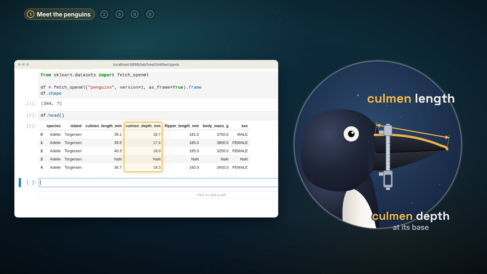

The first penguin is an Adélie from Torgersen (the data writes the name
without its accent, `Adelie`): its bill is 39.1 millimeters long and 18.7
deep, its flipper 181 millimeters, and it weighs 3,750 grams. But look at the
fourth row, number 3: `NaN` means not a number. Nothing was written down.

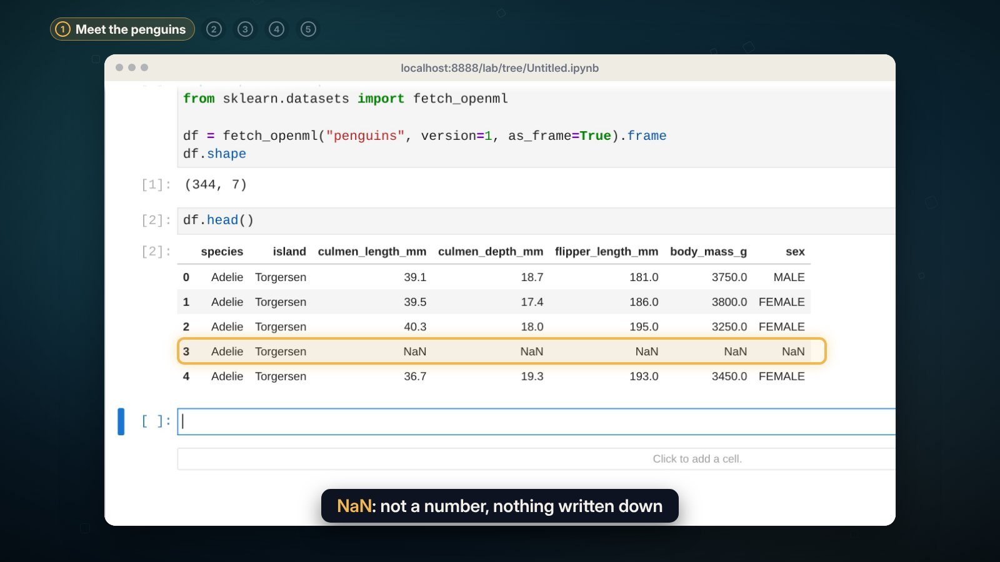

`isna` marks each gap, and `sum` counts them in each column:

```python
df.isna().sum()
```

Two penguins have no measurements at all (2 in each of the four measurement
columns), and 10 have no sex written down. `value_counts` counts each value
of the sex column; `dropna=False` counts the gaps too:

```python
df["sex"].value_counts(dropna=False)
```

168 males, 165 females, 10 gaps, and one penguin whose sex is an underscore,
`_`. That's a typo, kept in the data. Real data is messy. We won't use the
sex column, so it can stay.

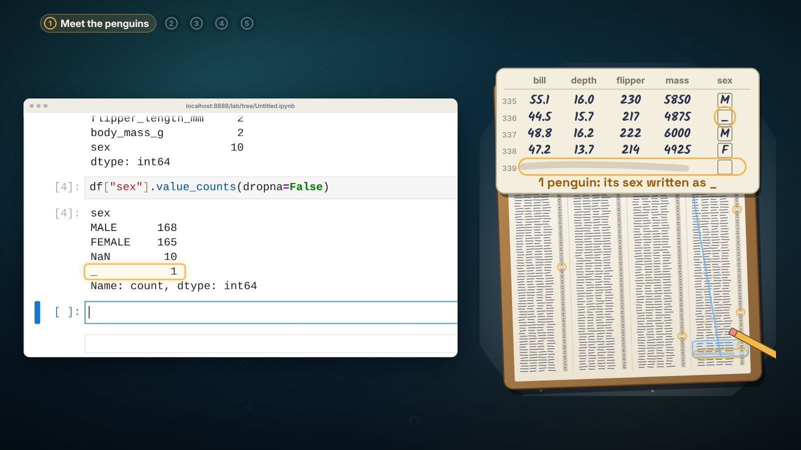

And how many of each species?

```python
df["species"].value_counts()
```

152 Adélies, 124 Gentoos and 68 Chinstraps. Three answers this time, and not
as many of each. Keep the Chinstraps in mind: they're the fewest.

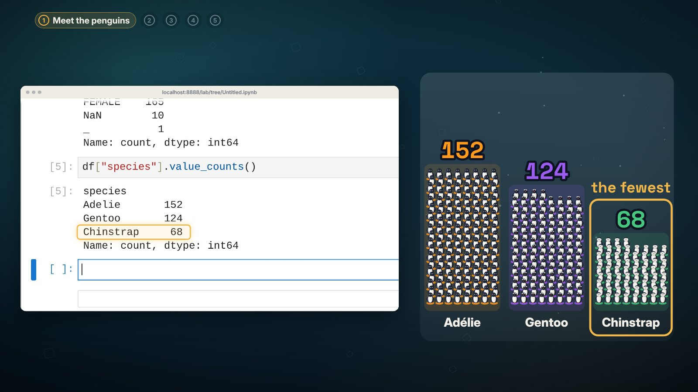

---

## Step 2: Ask the data

How do the species differ? The four measurements go in a list, called
`measures`. `groupby` makes a group of each species, `mean` averages each
measurement in it, and `round(1)` keeps one decimal.

```python
measures = ["culmen_length_mm", "culmen_depth_mm",
            "flipper_length_mm", "body_mass_g"]
df.groupby("species")[measures].mean().round(1)
```

Adélies have the shortest bills: 38.8 millimeters. Chinstraps and Gentoos
both have long bills, about 48 (48.8 and 47.5). The Gentoos' bills are the
shallowest: 15.0 millimeters deep, against about 18 for the other two. And
Gentoos have the longest flippers, 217.2 millimeters, and they're heavy:
5,076 grams, over 5 kilograms. The other two weigh about 3.7 kilograms.

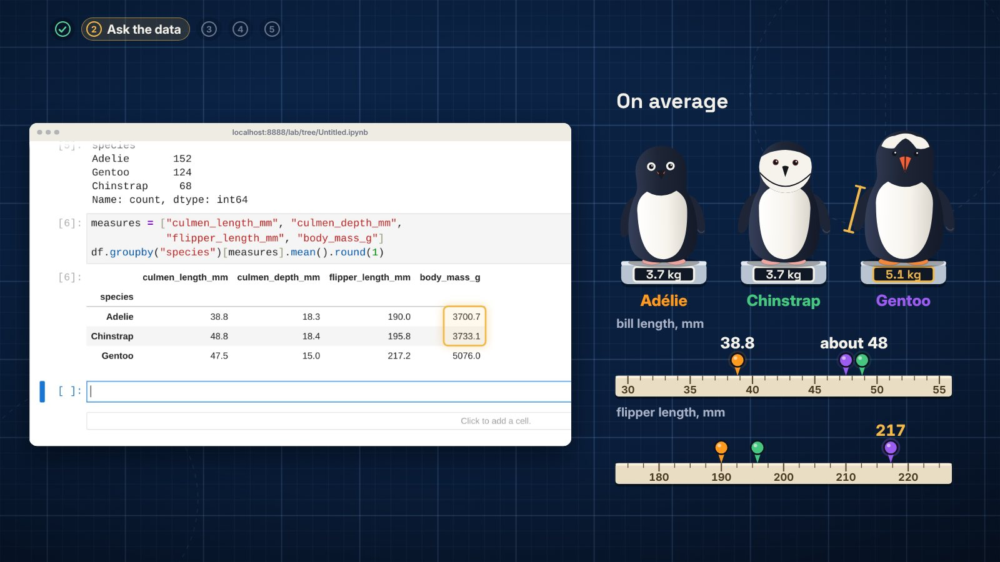

Let's look at the flippers. First a color for each species, orange, green and
purple, the colors scikit-learn's tree drawings use later. `pivot` makes one
column of flipper lengths for each species, and `plot.hist` draws the three
histograms over each other: `bins=30` sorts the lengths into 30 bins, and
`alpha=0.6` makes the bars see-through, so the overlap shows.

```python
colors = {"Adelie": "darkorange", "Chinstrap": "mediumseagreen",
          "Gentoo": "blueviolet"}
flips = df.pivot(columns="species", values="flipper_length_mm")
flips.plot.hist(bins=30, alpha=0.6, color=colors);
```

The Gentoos, in purple, stand apart, from about 203 millimeters up. The
Adélies and the Chinstraps overlap. So the flipper alone can find the
Gentoos. To tell the other two apart, we need more.

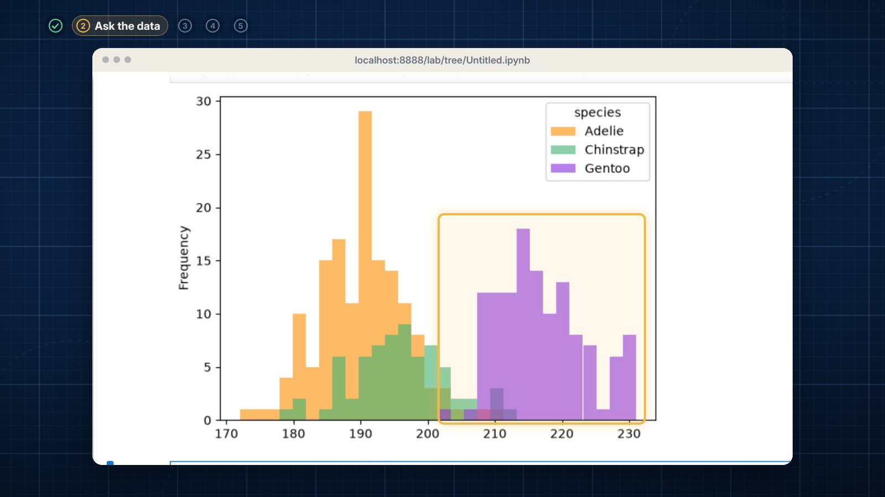

Now two measurements at once. `plot.scatter` puts each penguin at its flipper
length (`x`, across) and its bill length (`y`, up). `c` colors each dot by
its species: `astype(str)` makes the species plain text, and `map` looks up
its color.

```python
df.plot.scatter(x="flipper_length_mm", y="culmen_length_mm",
                c=df["species"].astype(str).map(colors));
```

Three clouds. Adélies at the bottom left: short flippers, short bills.
Chinstraps above them: short flippers, but long bills. And Gentoos on the
right. Two measurements already sort most of the penguins. That's what a
tree will find, one question at a time.

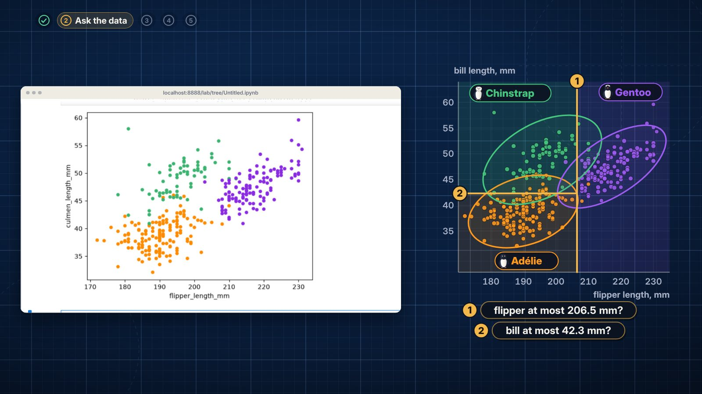

One more question: where do they live? `pd.crosstab` counts the penguins by
island and species:

```python
pd.crosstab(df["island"], df["species"])
```

The Adélies live on all three islands: 44 on Biscoe, 56 on Dream and 52 on
Torgersen. But the Chinstraps were only measured on Dream, and the Gentoos
only on Biscoe. Torgersen has only Adélies. So the island would give the
answer away here. But penguins swim, and a penguin from somewhere else would
fool it. We want a model that looks at the penguin itself, so we leave the
island out.

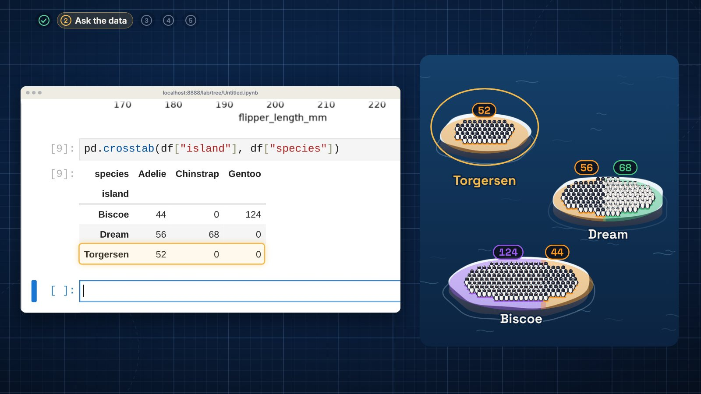

---

## Step 3: Get the data ready

The two penguins without measurements can't teach anything. `dropna`, with
`subset` set to our measures, drops the rows with a gap in one of the four
measurements (a gap in the sex column doesn't count):

```python
df = df.dropna(subset=measures)
len(df)
```

342 penguins left. `X` is the four measurements, the features. `y` is the
species, the answer we want: the target.

```python
X = df[measures]
y = df["species"]
```

Then we hide a test, like before: `train_test_split` keeps a quarter of the
penguins back, with `random_state=42` so you get the same numbers. One new
setting: `stratify=y`. With three answers, and only 68 Chinstraps, a random
split could leave the test with too few of them. `stratify` keeps the same
mix of species in both parts.

```python
from sklearn.model_selection import train_test_split

X_train, X_test, y_train, y_test = train_test_split(
    X, y, test_size=0.25, random_state=42, stratify=y)
y_train.value_counts()
```

256 penguins to learn from: 113 Adélies, 92 Gentoos and 51 Chinstraps. The
other 86 are the test, with the same mix.

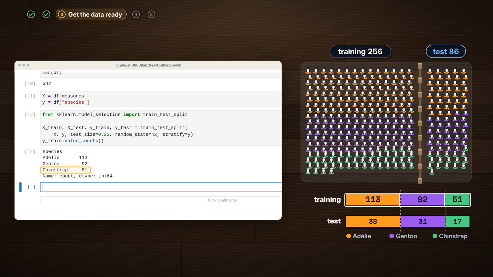

---

## Step 4: Look inside the tree

A decision tree asks yes-or-no questions, like: is the flipper at most 206.5
millimeters long? Each question splits the penguins into two groups. Each
group gets its own next question, and at the bottom, each leaf names a
species: the one most of its penguins have.

To choose a question, the tree tries many, and keeps the one that sorts the
penguins best: the one whose groups are the most pure, each as close as it
gets to a single species. So it needs a way to measure how mixed a group is.
There are two common ones. The first is the Gini impurity.

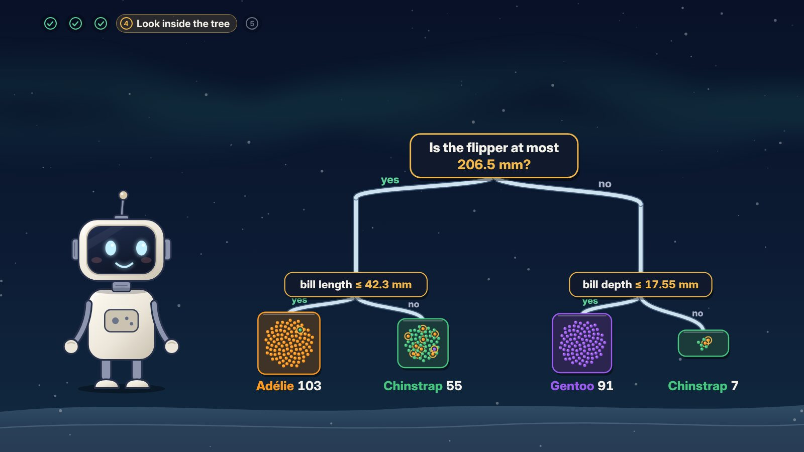

Here's the idea. Pick two penguins from a group at random. What's the chance
they're different species? If the group is all one species, the chance is
zero: the group is pure. The more mixed it is, the higher the chance.

The chance that both are Adélies is the share of Adélies, times itself: p
squared. The same for the other two species. Add the three squares up, and
that's the chance the two are the same species. One minus that is the chance
they're different. That's the Gini impurity. In a text cell:

```markdown
Gini impurity: $G = 1 - \sum_{k} p_k^2$
```

$k$ counts the species, and $p_k$ is the share of species $k$ in the group.

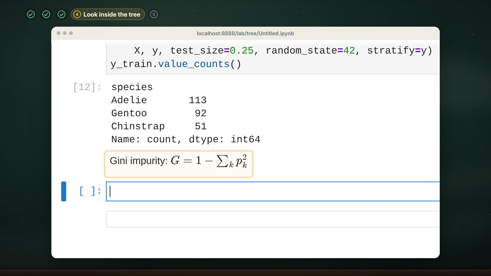

Let's compute it. Our `gini` function takes a group's species.
`value_counts(normalize=True)` gives each species' share instead of its
count, and the function returns 1 minus the sum of their squares:

```python
def gini(species):
    p = species.value_counts(normalize=True)
    return 1 - (p ** 2).sum()

print(round(gini(y_train), 3))
```

On the training penguins: 0.636. The shares are 0.441 Adélies (113 of 256),
0.359 Gentoos (92) and 0.199 Chinstraps (51). Squared and added up, with all
their decimals, that's 0.364: about a one in three chance that two random
penguins are the same species. And 1 minus 0.364 is 0.636.

With three species, the most mixed a group can be is a third of each: 1 minus
3 ninths, 0.667. So our penguins are almost as mixed as they can be.

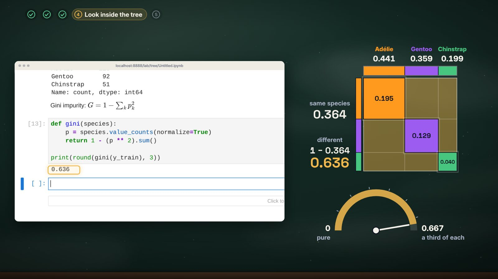

The second measure comes from information theory: entropy. Think of a
guessing game. I pick a penguin from a group, and you guess its species by
asking me yes-or-no questions. How many do you need? If the group is all
Adélies, none: you already know. If it's half Adélies and half Gentoos, one
question. With four species in equal numbers, two questions. Each yes-or-no
answer is one bit. Entropy is the fewest bits you need, on average, with the
cleverest questions.

```markdown
Entropy, in bits: $H = -\sum_{k} p_k \log_2 p_k$
```

$-\log_2 p_k$ is the same as $\log_2 \frac{1}{p_k}$. A rare species surprises
you more, and $\log_2 \frac{1}{p}$ counts how many bits that surprise is
worth; entropy averages it over the species, each weighted by its share.

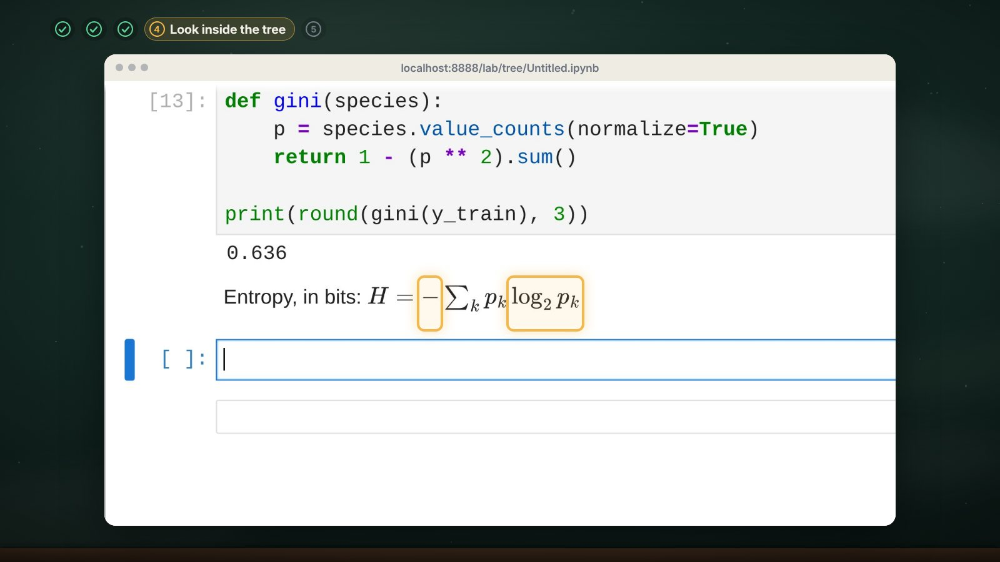

Our `entropy` function: the same shares, but `p[p > 0]` keeps only the
species the group has, because the log of zero has no value. Then minus the
sum of p times NumPy's `log2` of p.

```python
import numpy as np

def entropy(species):
    p = species.value_counts(normalize=True)
    p = p[p > 0]
    return -(p * np.log2(p)).sum()

print(round(entropy(y_train), 3))
```

On the training penguins: 1.515 bits. With three species in equal numbers, it
would be 1.58, the log base 2 of 3. So again: almost as mixed as it gets.
Gini and entropy measure the same thing, how mixed a group is, on different
scales: Gini in chances, entropy in bits.

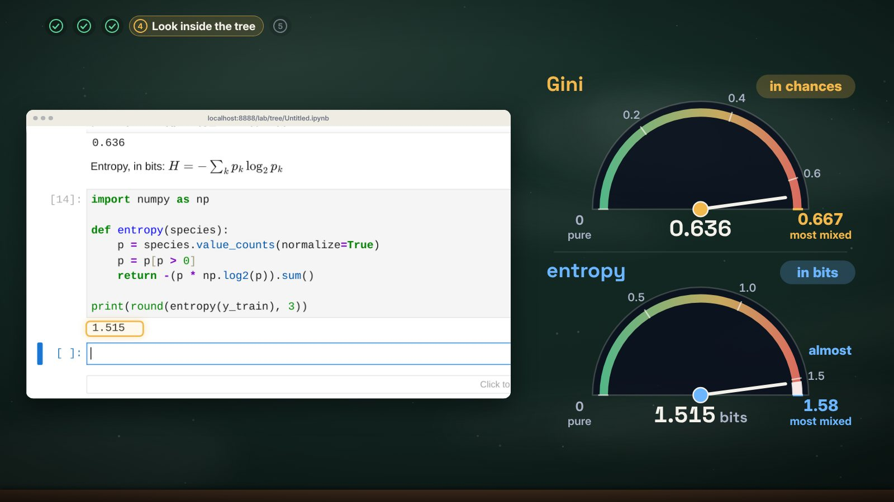

Now a question. Our `after` function scores it: it splits the training
penguins at a cut, and measures both groups with `measure`, which is `gini`
or `entropy`. `left` is true for the penguins whose feature is at most the
cut, and `~left` for the others. `share` is the fraction of penguins on the
left. The score is the average of the two groups' impurity, each weighted by
its share of the penguins: a big group counts more than a small one.

```python
def after(feature, cut, measure):
    left = X_train[feature] <= cut
    share = left.mean()
    return (share * measure(y_train[left])
            + (1 - share) * measure(y_train[~left]))

print(round(after("flipper_length_mm", 206.5, gini), 3))
```

We try the flipper at 206.5 millimeters:

| Group | Penguins | Adélies | Chinstraps | Gentoos | Gini |
| --- | --- | --- | --- | --- | --- |
| Left: at most 206.5 mm | 158 | 111 | 46 | 1 | 0.422 |
| Right: longer | 98 | 2 | 5 | 91 | 0.135 |

Weighted together, 158/256 of 0.422 plus 98/256 of 0.135: 0.312. One
question, and the impurity falls from 0.636 to about half.

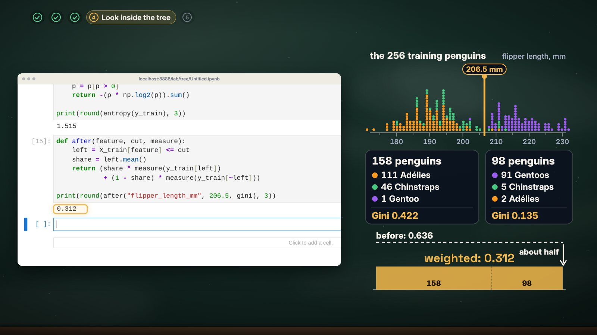

With entropy, the fall has a name: information gain. It's the entropy before
the question, minus the weighted entropy after it:

```markdown
Information gain: $IG = H(\text{before}) - \sum_{i} \dfrac{n_i}{n} H(\text{group}_i)$
```

The sum runs over the groups: $n_i$ is the number of penguins in group $i$
and $n$ all of them, so $\frac{n_i}{n}$ is the group's share.

```python
gain = entropy(y_train) - after("flipper_length_mm", 206.5, entropy)
print(round(gain, 3))
```

For our flipper question: 1.515 bits before, 0.735 after. The question gains
0.78 bits: about half of what we needed to know, from one question.

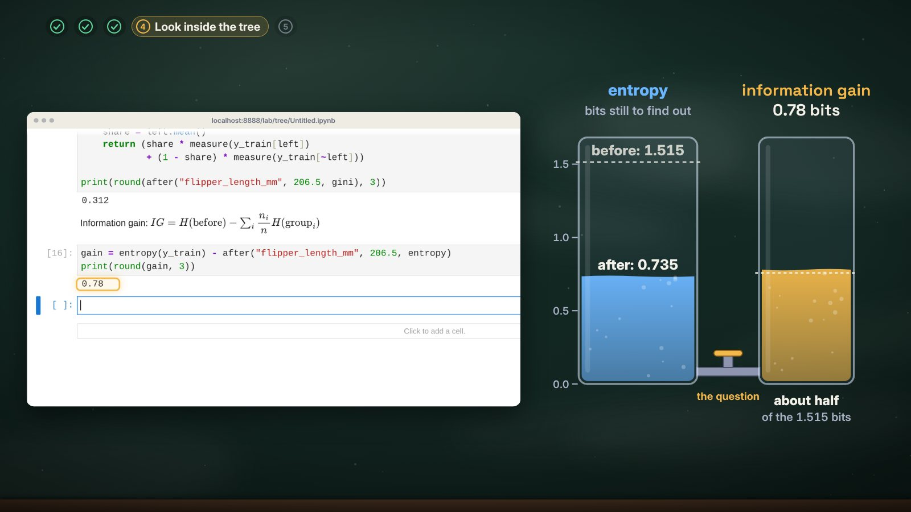

But why 206.5? The tree doesn't guess. It tries every cut there is. Our
`best_cut` function sorts the different values of a measurement (`unique`
drops the repeats) and puts a cut halfway between each neighbor and the
next: `v[1:]` is every value but the first, `v[:-1]` every value but the
last, and their average is the halfway points. It scores each cut with
`after`, and `np.argmin` finds the lowest score. It returns how many cuts it
tried, the best cut, and its score.

```python
def best_cut(feature, measure):
    v = np.sort(X_train[feature].unique())
    cuts = (v[1:] + v[:-1]) / 2
    scores = [after(feature, c, measure) for c in cuts]
    i = np.argmin(scores)
    return len(cuts), float(cuts[i]), round(float(scores[i]), 3)

for feature in measures:
    print(feature, best_cut(feature, gini))
```

51 cuts for the flipper lengths. With Gini, the flipper wins, at 206.5:
0.312. Bill length at 42.3 is close, 0.324, then bill depth, then weight.

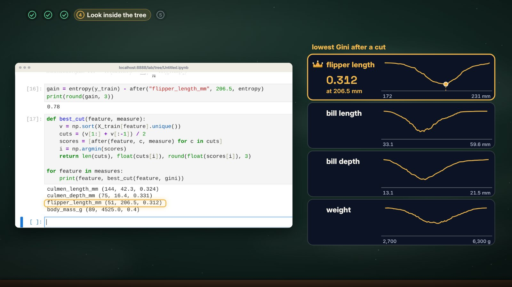

And with entropy:

```python
for feature in measures:
    print(feature, best_cut(feature, entropy))
```

The flipper wins again, at the same 206.5. But second place changes: bill
depth beats bill length.

| Measurement | Cuts | Best cut, Gini | Gini after | Best cut, entropy | Entropy after |
| --- | --- | --- | --- | --- | --- |
| `culmen_length_mm` | 144 | 42.3 | 0.324 | 42.3 | 0.788 |
| `culmen_depth_mm` | 75 | 16.4 | 0.331 | 16.4 | 0.778 |
| `flipper_length_mm` | 51 | 206.5 | **0.312** | 206.5 | **0.735** |
| `body_mass_g` | 89 | 4,525 | 0.4 | 4,175 | 0.985 |

359 cuts in all, each a question scored by hand. That's all the tree does, at
every branch.

Now scikit-learn's tree. `DecisionTreeClassifier`, with `random_state=0` so
it comes out the same every time. `fit` grows it on the training penguins.

```python
from sklearn.tree import DecisionTreeClassifier

tree = DecisionTreeClassifier(random_state=0)
tree.fit(X_train, y_train)
print(tree.get_depth(), tree.get_n_leaves())
```

`get_depth`: it asks up to 7 questions in a row. `get_n_leaves`: 14 leaves.

`plot_tree` draws it, and `plt.figure` gives the drawing room (`figsize`, in
inches). `max_depth=1` shows just the top: the first question, and the two
groups under it. `feature_names` and `class_names` write the measurements'
and the species' names in the boxes, and `filled=True` colors each box by the
species most of its penguins have.

```python
import matplotlib.pyplot as plt
from sklearn.tree import plot_tree

plt.figure(figsize=(10, 5))
plot_tree(tree, max_depth=1, feature_names=measures,
          class_names=tree.classes_, filled=True);
```

`flipper_length_mm <= 206.5`. `gini = 0.636`, for 256 penguins (`samples`):
113, 51 and 92 (`value`, the species in alphabetical order: Adélie,
Chinstrap, Gentoo). Our numbers, exactly. And under it, the left group: Gini
0.422. The right: 0.135. The same as ours. That's how a tree picks a
question.

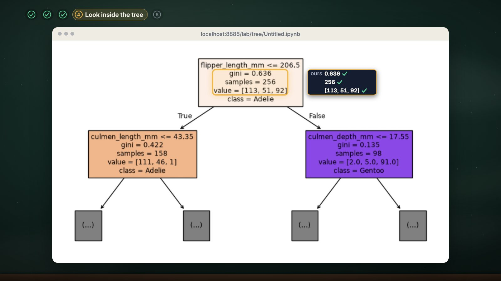

How good is it on the penguins it learned from? `score` gives the share it
gets right:

```python
tree.score(X_train, y_train)
```

1.0: every one right. Remember episode 1: a tree that grows until every leaf
is pure can learn its training data by heart. Some of its 14 leaves hold just
one or two penguins.

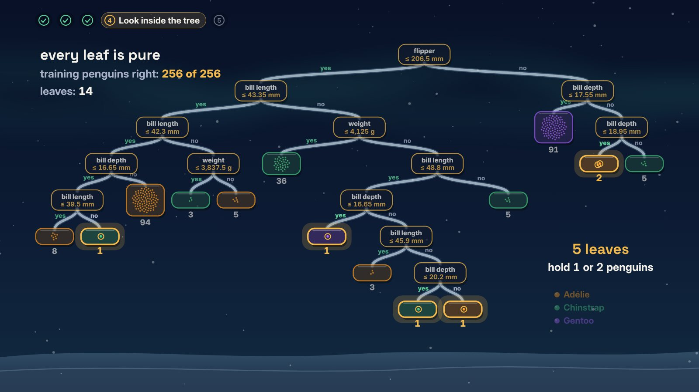

Which measure is better? `cross_val_score`, from episode 2, scores a tree
five times, each time on a different fifth of the training penguins (it
learns from the other four fifths), and `mean` averages the five scores. We
loop over the two measures, with `criterion` set to each.

```python
from sklearn.model_selection import cross_val_score

for measure in ["gini", "entropy"]:
    t = DecisionTreeClassifier(criterion=measure, random_state=0)
    print(measure, cross_val_score(t, X_train, y_train).mean().round(3))
```

Gini: 0.965, 96.5 in 100 right. Entropy: 0.973. That's about two penguins
out of 256: close. Most of the time, the two pick the same questions, as they
did for our first one. Gini is a little faster, without the logarithm, so
it's the default. Here entropy is a hair better, so we keep it.

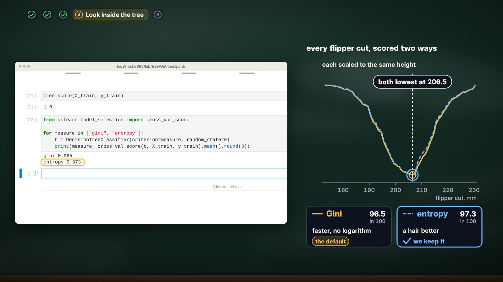

---

## Step 5: Prune it

A tree that learns by heart grows branches for a single odd penguin. Pruning
cuts those branches back. Cost-complexity pruning gives each tree a cost:

```markdown
Cost-complexity pruning: $R_\alpha(T) = R(T) + \alpha \, |T|$
```

$R(T)$ is how impure its leaves are (each leaf's impurity, weighted by its
share of the penguins), plus $\alpha$ (alpha) times $|T|$, the number of
leaves. Alpha is a price per leaf. At zero, leaves are free, and the whole
tree stays. The higher alpha gets, the more a branch must earn its leaves,
and the weakest branches go first.

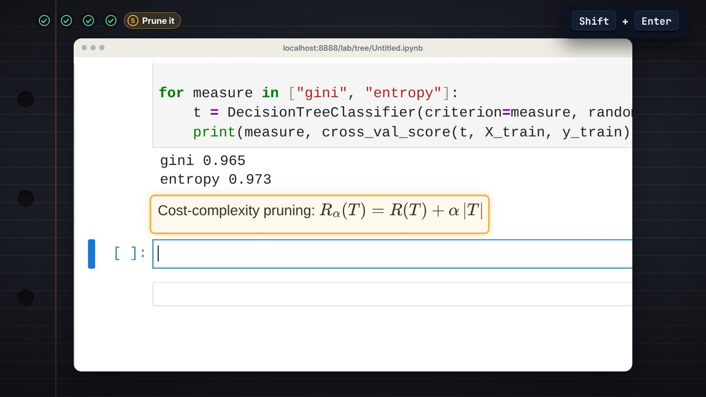

We grow a full tree with entropy, called `deep`.
`cost_complexity_pruning_path` lists every alpha where a branch falls off,
in `ccp_alphas`; `round(4)` keeps four decimals.

```python
deep = DecisionTreeClassifier(criterion="entropy", random_state=0)
path = deep.cost_complexity_pruning_path(X_train, y_train)
path.ccp_alphas.round(4)
```

Eleven of them, from 0 to 0.7801. The last one cuts the tree down to its
root, a single leaf, so `[:-1]` leaves it out. For each of the others, we
grow a pruned tree (`ccp_alpha=a`), count its leaves, and score it with
cross-validation:

```python
for a in path.ccp_alphas[:-1]:
    t = DecisionTreeClassifier(criterion="entropy", ccp_alpha=a,
                               random_state=0)
    t.fit(X_train, y_train)
    score = cross_val_score(t, X_train, y_train).mean()
    print(round(a, 4), t.get_n_leaves(), round(score, 3))
```

From 12 leaves down to 8, the score stays at 0.973. Prune more, and it drops:
0.965 with 7 leaves, down to 0.887 with 2. Same score, fewer leaves: we keep
the simplest. Alpha 0.0159, and 8 leaves.

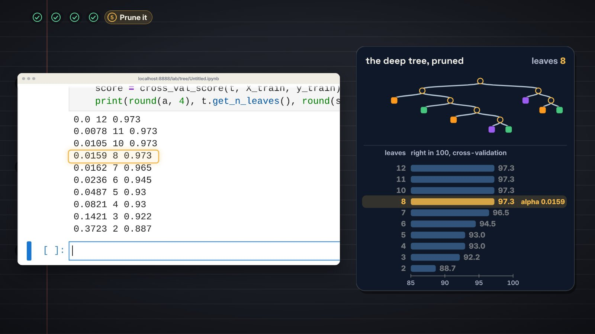

Our final tree: `criterion="entropy"`, `ccp_alpha=0.0159`. `fit`, then, for
the first and only time, the test:

```python
final = DecisionTreeClassifier(criterion="entropy", ccp_alpha=0.0159,
                               random_state=0)
final.fit(X_train, y_train)
print(final.get_n_leaves(), final.score(X_test, y_test))
```

8 leaves, and 0.988 on the test: 85 of the 86 penguins it has never seen,
right.

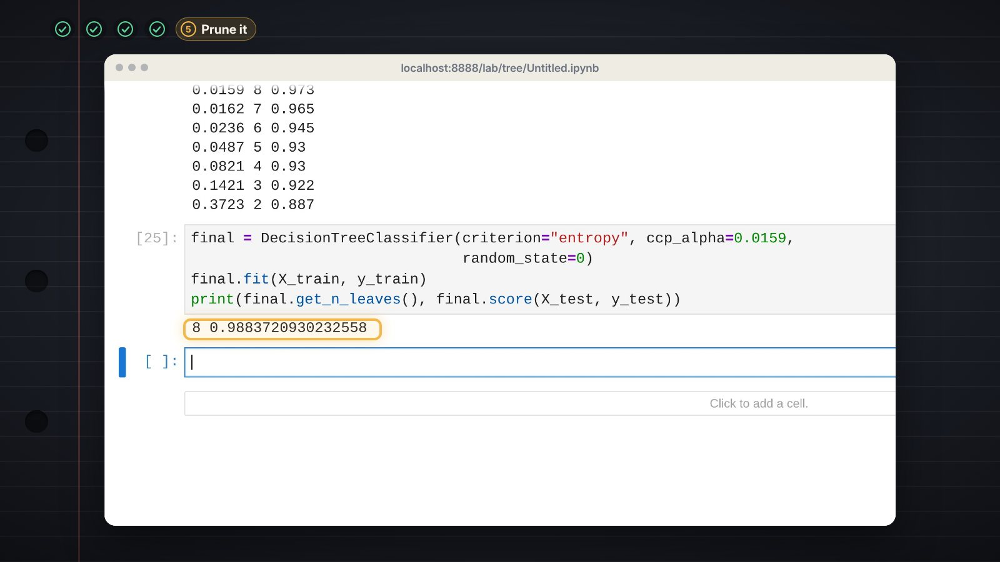

`plot_tree` draws it whole, in a bigger drawing room:

```python
plt.figure(figsize=(14, 9))
plot_tree(final, feature_names=measures,
          class_names=final.classes_, filled=True);
```

It asks at most five questions. First the flipper. Then, for the short
flippers, the bill length: Adélies have short bills. For the long flippers,
the bill depth: Gentoos have shallow bills. Each box shows its question, its
entropy, how many penguins it holds (`samples`), and how many of each species
(`value`).

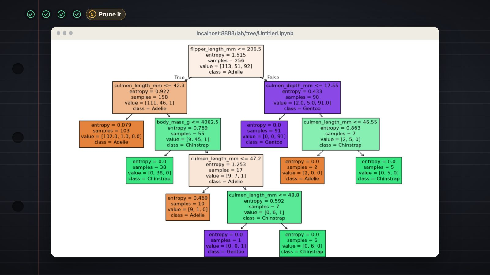

Which one did it miss? `pd.crosstab` puts the true species down the side, and
the tree's guess across: `colnames` gives that side its name.

```python
pd.crosstab(y_test, final.predict(X_test), colnames=["guess"])
```

37 Adélies, 17 Chinstraps and 31 Gentoos, right. And one Adélie it called a
Chinstrap. It's a male from Torgersen, and its bill is 43.1 millimeters long.
Adélie bills average 38.8. Its bill is past the tree's cut at 42.3, so the
tree followed the bill down the Chinstraps' side.

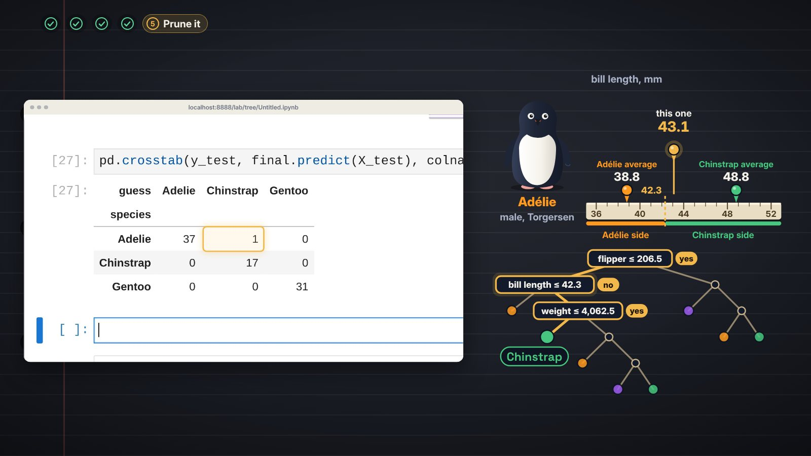

Finally, a penguin of our own: a bill 46 millimeters long and 18.5 deep, a
flipper of 200 millimeters, and 4,300 grams, in a table of one row with the
same columns as `X`. `predict` names its species, and `predict_proba` gives
the tree's three chances, one for each species:

```python
penguin = pd.DataFrame([[46.0, 18.5, 200.0, 4300.0]],
                       columns=measures)
print(final.predict(penguin))
pd.DataFrame(final.predict_proba(penguin),
             columns=final.classes_).round(2)
```

`predict` says: Adélie. Adélie, 0.9. Chinstrap, 0.1. Gentoo, 0. Down the
tree: its flipper, 200, is at most 206.5; its bill, 46, is longer than 42.3;
it weighs more than 4,062.5 grams; and its bill is at most 47.2. That leaf
held 10 training penguins: 9 Adélies and one Chinstrap. That's more than two
answers: three chances that add up to one.

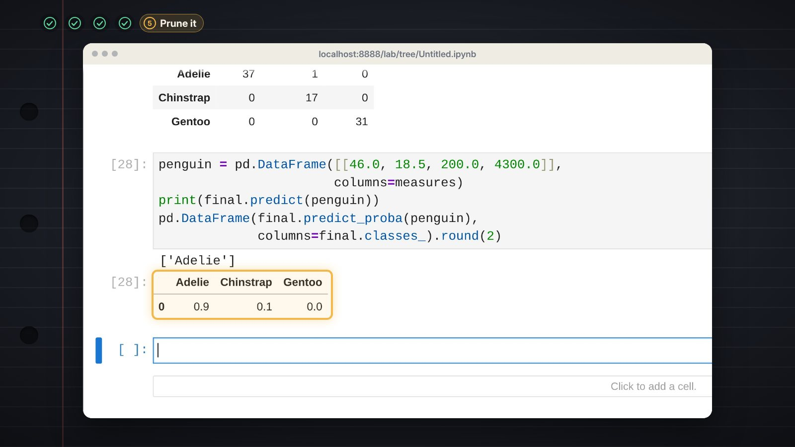

The tree knows only these three species: show it a penguin of another kind,
and it still names one of the three. Next time: a team of trees. Back to the
houses of Ames: why one tree is shaky, and how many trees together (bagging,
random forests and boosting) make a steadier guess.

---

## The versions in the video

Recorded on 7 November 2026 on Linux, in the `ml` box from episode 0:
Python 3.14.10, NumPy 2.5.4, pandas 3.1.1, scikit-learn 1.9.1,
matplotlib 3.11.2 and JupyterLab 4.6.5. The data is OpenML's
[penguins](https://www.openml.org/d/42585) (version 1, license: CC0), the
palmerpenguins data, collected and made available by Dr. Kristen Gorman and
the Palmer Station, Antarctica LTER, a member of the Long Term Ecological
Research Network. The study: Gorman, Williams and Fraser, "Ecological Sexual
Dimorphism and Environmental Variability within a Community of Antarctic
Penguins (Genus Pygoscelis)", PLoS ONE 9(3): e90081, 2014. OpenML's copy is
derived from the R package palmerpenguins (Horst, Hill and Gorman,
"palmerpenguins: Palmer Archipelago (Antarctica) penguin data", R package
version 0.1.0, 2020), and writes one Gentoo's sex as `_` where the package
has a gap.
